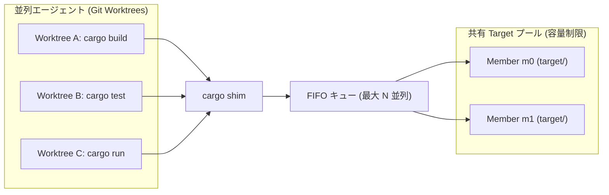
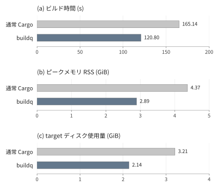
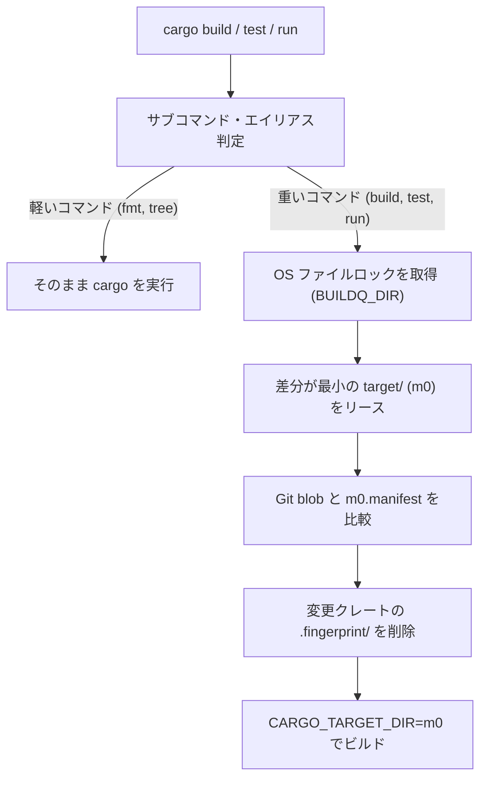

# buildq

[English](README.md) | 日本語

**複数の Git worktree で並列実行される `cargo` ビルドを制御する、<br>デーモンレスなジョブキュー兼 `target/` 共有プール**

## Why buildq?

複数のコーディングエージェントが別々の Git worktree で同時に `cargo` を実行すると、3つの問題が発生する。

- **CPU・メモリの枯渇**
  - 複数エージェントの同時コンパイルによるマシンのフリーズ
- **ディスク容量の爆発**
  - worktree ごとに巨大な `target/`（5〜20 GB）が生成
  - 数時間で数十 GB のディスク容量を消費
- **単純な `CARGO_TARGET_DIR` 共有の危険性**
  - ロック競合による全ビルドの直列化
  - 更新日時（`mtime`）のズレにより、**古いコードが再利用されるバグ**が発生

`buildq` は透過的な `cargo` shim として動作する。
`buildq` はバックグラウンドデーモンなしで、これら3つの問題をすべて解決する。



### Key Features

- **透過的な `cargo` shim**
  - 重いコマンド（`build`, `test`, `clippy`, `run`, `nextest` 等）のみ自動でキューへ投入
  - 軽いコマンド（`fmt`, `metadata`, `tree`, `--version` 等）はそのまま即座に実行
- **マシン全体のジョブキュー**
  - 同時ビルド数を上限（デフォルト: `2`）に制限し、優先度付き FIFO 順で実行
  - OS のファイルロック（`flock` / `LockFileEx`）によるデーモンレス設計
  - プロセス強制終了時もロックが自動解放され、残留なし
- **安全な `target/` 共有プール**
  - 少数の `target/` ディレクトリを全 worktree 間で安全に共有
  - Git の blob ハッシュでファイル内容を追跡
  - 変更されたパッケージのキャッシュのみをビルド前に無効化
  - workspace 内の推移的な依存元も含む再ビルド数で空きメンバーを選択
- **ディスク容量制限と自動 GC**
  - 不要なインクリメンタルキャッシュや古い成果物をバックグラウンドで自動削除
  - プール全体のサイズを指定上限（デフォルト: `60 GB`）以下に維持
- **ファイルをロックしない `cargo run`**
  - ビルド完了後、実行ファイルと DLL を専用ディレクトリへコピーしてから起動
  - アプリ実行中の `target/` ロック（Windows 等）による後続ビルドの失敗を防止
- **SSH リモートビルド**
  - 軽量な差分 Git スナップショットを用い、別マシンへビルドをオフロード

### Performance & Impact

Bevy を使う **3 つの worktree の同時ビルド**で実測。
共有キャッシュの再利用により、ビルド時間とリソース消費を削減。



<details>
<summary>測定値・実行環境</summary>

| 指標 | 通常 Cargo<br>独立 target | buildq<br>共有プール |
| :--- | ---: | ---: |
| ビルド時間 | 165.14 秒 | 120.80 秒 |
| ピーク RSS | 4.37 GiB | 2.89 GiB |
| target ディスク割当量 | 3.21 GiB | 2.14 GiB |

- Bevy 0.16.1：PBR・PNG・マルチスレッド
- Linux x86_64、Rust 1.89.0
- CPU quota 4・メモリ 16 GiB、Cargo ごとに 2 jobs
- buildq：2 slots・最大 2 members
- 全キャッシュが空の状態から測定
- 測定日：2026-10-23

</details>

[測定方法・補足結果・注意点は詳細レポートへ](docs/benchmarks/bevy-2026-10-23.ja.md)

## Installation

### 1. Install the binary

```sh
cargo install --git https://github.com/r4ai/buildq
```

### 2. Install the `cargo` shim

専用ディレクトリに shim を作成し、`PATH` の**先頭**に追加する。

**macOS / Linux**
```sh
buildq shim install cargo --into ~/.local/share/buildq/bin
export PATH="$HOME/.local/share/buildq/bin:$PATH"
```

**Windows (PowerShell)**
```powershell
buildq shim install cargo --into C:\bq\bin
$env:PATH = "C:\bq\bin;$env:PATH"
```

> [!TIP]
> サンドボックス化された複数エージェントで共有する場合は、`BUILDQ_DIR` と `BUILDQ_CACHE` を共通の書き込み可能ディレクトリに設定する。
> 手順は [マルチエージェント・サンドボックス設定レシピ](docs/development.ja.md#multi-agent-sandbox-recipe) を参照

## Usage

### Everyday Use

`PATH` に shim を追加した後は、通常通り `cargo` コマンドを実行するだけでよい。

```sh
cargo build
cargo test
cargo run
```

重いコマンドは自動的にキューイングされ、割り当てられたプールメンバーが表示される。

```text
buildq: target <pool>/m0 (...)
```

### CLI Commands

| コマンド | 説明 |
| :--- | :--- |
| `buildq status [--hosts]` | クラスごとの実行中・待機中ジョブを表示 |
| `buildq top [--interval SECONDS] [--iterations N]` | キュー・待機時間・リモートホスト・プール使用量を定期表示 |
| `buildq history [-n N]` | 直近のジョブ履歴を表示<br>（待機時間・実行時間・終了コード・使用プール） |
| `buildq cache ls [--refresh]` | プール一覧・各メンバーの容量・空き容量を表示 |
| `buildq gc [--dry-run]` | キャッシュを手動整理し、ディスク予算内に縮小 |
| `buildq config` | 現在有効な設定値とディレクトリパスを表示 |
| `buildq run [-p PRIO] -- <cmd>...` | 任意のコマンドをキュー経由で実行（優先度指定可） |
| `buildq run --host <H> -- <cmd>...` | SSH 経由でリモートホスト上でコマンドを実行 |

`buildq top` は端末上で2秒ごとに更新する。終了は Ctrl+C。
リダイレクト時は1回だけ表示する。`--iterations N` で更新回数を指定できる。
継続表示中のリモート照会はバックグラウンドで行う。
プール容量は `buildq cache ls` と同じキャッシュ済み計測値を使用する。

### Configuration (`config.toml`)

設定はすべて任意。
`$BUILDQ_DIR/config.toml` に配置する（標準パスは `buildq config` で確認可能）。

```toml
slots = 2                # ビルドの最大同時実行数 (デフォルト: 2)
run_slots = 2            # `cargo run` のアプリ最大同時実行数 (デフォルト: 2)

[cache]
max_members = 3          # リポジトリ×ツールチェインあたりの最大 target/ 数 (デフォルト: slots + 1)
budget = "45G"           # BUILDQ_CACHE 全体の最大ディスク使用量 (デフォルト: "60G")
min_free = "25G"         # ドライブ上に最低限残す空き容量 (デフォルト: "20G")
# pool_explicit = true   # worktree 内を指す --target-dir / CARGO_TARGET_DIR もプールする (デフォルト: false)

[cargo]
rustc_wrapper = "none"   # ジョブごとにグローバルな sccache 等を無効化 ("none" | "keep" | "/path")
# jobs = 8               # 1ビルドあたりの CARGO_BUILD_JOBS (デフォルト: コア数 / slots)
```

### Remote Builds (SSH)

`config.toml` にホストを追記すると、SSH と Git 経由でリモートマシンへビルドを分散できる。

```toml
[hosts.box]
ssh = "box"              # ~/.ssh/config のホスト名
slots = 4                # このホストへ同時に送る最大ジョブ数

auto_hosts = ["local", "box"]
```

ホスト名を指定するか、`auto` で空きホストを自動選択して実行する。

```sh
buildq run --host box -- cargo test
buildq run --host auto -- cargo clippy --all-targets
buildq run --host box --fetch target/debug/app -- cargo build --bin app
```

## How It Works



1. **OS ファイルロックによるデーモンレスキュー**
   - `$BUILDQ_DIR` 内のファイルを OS レベル（`flock` / `LockFileEx`）で排他ロック
   - プロセス異常終了時も OS が自動でロックを解放し、デッドロックを防止
   - 再帰的な `cargo` 呼び出しは環境変数 `BUILDQ_HELD` で検知してバイパス
2. **Git Blob マニフェストによる安全なキャッシュ無効化**
   - Cargo はワークスペース内クレートを相対パスでハッシュ化するため、別 worktree でも成果物を再利用可能
   - 各メンバーに全ソースファイルの Git blob ID（`m0.manifest`）を記録
   - ビルド前に現在の worktree と比較し、**変更パッケージの `.fingerprint/<pkg>-*` のみを削除**
   - ソースルートが変わる場合は全ローカルパッケージを無効化し、`CARGO_MANIFEST_DIR` などの埋め込みパスを現在の worktree に更新
   - registry／git 依存のキャッシュは共有し、同一ルートでは通常のインクリメンタルビルドを維持
   - `mtime` に依存せず、安全かつ高速なインクリメンタルビルドを実現
3. **`cargo run` の2フェーズ分割**
   - フェーズ1：`build` スロットでビルドし、実行ファイルと DLL を `runs/r0` に差分コピー
   - フェーズ2：`build` スロットと `target/` メンバーを解放後、`run` スロットでアプリを起動
   - アプリ実行中も `target/` がロックされず、他エージェントがビルドを継続可能

## Documentation

- **[アーキテクチャと内部設計](docs/architecture.ja.md)**
   - キューのロック設計・マニフェスト無効化の不変条件・メンバー選択アルゴリズム
   - 5段階 GC・SSH リモートプロトコル・既知の制限事項
- **[開発・セットアップガイド](docs/development.ja.md)**
   - モジュール構成・単体 / E2E テストの実行手順
   - マルチエージェント用サンドボックス設定・環境変数一覧

## Releases

Rust edition は 2024、MSRV は 1.89 である。CI とリリースには
`rust-toolchain.toml` の Rust 1.99.0 を使用する。
ツールチェーン更新時は両バージョンの CI 成功を確認する。
CI は整形、厳格な Clippy、ドキュメント、依存関係、および Linux・macOS・Windows
での実 Cargo E2E を検査する。Dependabot は週次・グループ単位で更新を提案し、
7 日間のクールダウンを設ける。セキュリティ更新は速やかにレビューする。

1. `Cargo.toml` の `package.version` を更新し、`cargo update` で `Cargo.lock` を更新する。
   レビューと CI 成功後、`main` にマージする
2. 対象コミットに `git tag -a v0.1.0 -m "Release v0.1.0"` でタグを付け、
   `git push origin v0.1.0` でタグを送信する。バージョンは適宜置き換える
3. タグ用ワークフローが CI、バージョン一致、`main` の履歴への所属を再検査する。
   Linux・macOS の x86_64/aarch64 と Windows x86_64 向けバイナリをビルドし、
   アーカイブ、ライセンス、`SHA256SUMS`、GitHub 自動生成のリリースノートを公開する

`v0.2.0-rc.1` などのタグは `Cargo.toml` と同じバージョンを必要とし、プレリリースを作成する。
各アーカイブの来歴は `gh attestation verify ARCHIVE --repo r4ai/buildq` で検証できる。
ダウンロード後は `sha256sum -c SHA256SUMS`、macOS では
`shasum -a 256 -c SHA256SUMS` でチェックサムを確認する。
全アセットのアップロード後にドラフトを公開する。
公開処理がドラフト作成後に失敗した場合、ドラフトを確認・削除してから失敗ジョブを再実行する。
公開済みタグは移動しない。

管理者は Actions と artifact attestations、Dependabot security updates、
非公開の脆弱性報告を有効にし、`main` の ruleset で **CI passed** を必須にする。
`v*` タグの作成・更新・削除はリリース担当者に制限する。
公開リポジトリでは `GITHUB_TOKEN` と GitHub OIDC のみを使用し、PAT や署名用秘密鍵は不要である。
[Security policy](SECURITY.md) も参照する。

## License

MIT または Apache-2.0 のデュアルライセンス（[LICENSE-MIT](LICENSE-MIT) / [LICENSE-APACHE](LICENSE-APACHE)）
