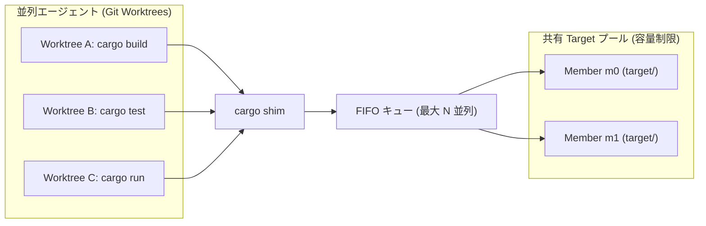
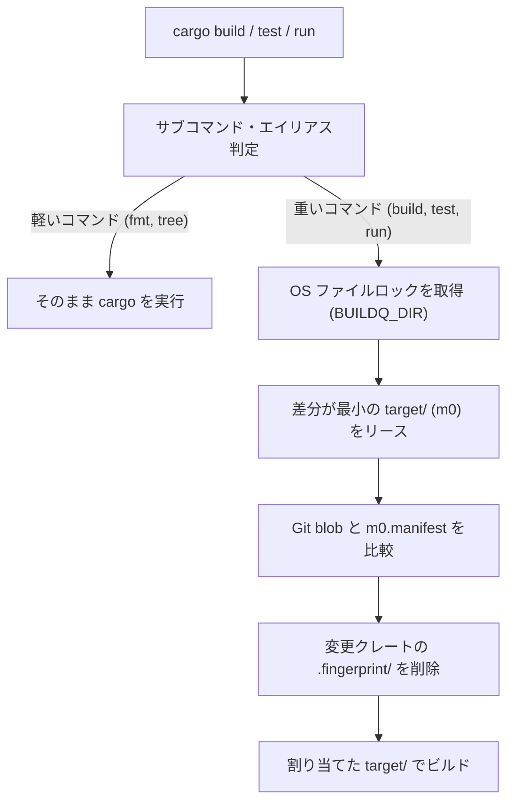

# buildq

[English](README.md) | 日本語

**複数の Git worktree で並列実行される `cargo` ビルドを制御する、<br>デーモンレスなジョブキュー兼 `target/` 共有プール**

## Why buildq?

複数のコーディングエージェントが別々の Git worktree で同時に `cargo` を実行すると、3つの問題が発生する。

- **CPU・メモリの枯渇**
  - 複数エージェントの同時コンパイルによるマシンのフリーズ
- **ディスク容量の爆発**
  - worktree ごとに巨大な `target/`（5〜20 GB）が生成
  - 数時間で数十 GB のディスク容量を消費
- **単純な `CARGO_TARGET_DIR` 共有の危険性**
  - ロック競合による全ビルドの直列化
  - 更新日時（`mtime`）のズレにより、**古いコードが再利用されるバグ**が発生

`buildq` は透過的な `cargo` shim として動作する。
`buildq` はバックグラウンドデーモンなしで、これら3つの問題をすべて解決する。



### Key Features

- **透過的な `cargo` shim**
  - 重いコマンド（`build`, `test`, `clippy`, `run`, `nextest` 等）のみ自動でキューへ投入
  - 軽いコマンド（`fmt`, `metadata`, `tree`, `--version` 等）はそのまま即座に実行
- **マシン全体のジョブキュー**
  - 同時ビルド数を上限（デフォルト: `2`）に制限し、優先度付き FIFO 順で実行
  - OS のファイルロック（`flock` / `LockFileEx`）によるデーモンレス設計
  - プロセス強制終了時もロックが自動解放され、残留なし
- **安全な `target/` 共有プール**
  - 少数の `target/` ディレクトリを全 worktree 間で安全に共有
  - Git の blob ハッシュでファイル内容を追跡
  - 変更されたパッケージのキャッシュのみをビルド前に無効化
- **ディスク容量制限と自動 GC**
  - 不要なインクリメンタルキャッシュや古い成果物をバックグラウンドで自動削除
  - 容量予算（デフォルト: `60 GB`）に向けて未使用キャッシュを回収
  - メンバー間の同一成果物を reflink で共有（btrfs・XFS・APFS）
- **実行ファイルを分離する `cargo run`**
  - ビルド完了後、実行ファイルと DLL を専用ディレクトリへコピーしてから起動
  - アプリ実行中の `target/` ロック（Windows 等）による後続ビルドの失敗を防止
- **SSH リモートビルド**
  - 軽量な差分 Git スナップショットを用い、別マシンへビルドをオフロード

### Performance & Impact

Bevy を使う **3 つの worktree の同時ビルド**で実測。
共有キャッシュの再利用により、ビルド時間とリソース消費を削減。


<details>
<summary>測定値・実行環境</summary>

| 指標 | 通常 Cargo<br>独立 target | buildq<br>共有プール |
| :--- | ---: | ---: |
| ビルド時間 | 165.14 秒 | 120.80 秒 |
| ピーク RSS | 4.37 GiB | 2.89 GiB |
| target ディスク割当量 | 3.21 GiB | 2.14 GiB |

- Bevy 0.16.1：PBR・PNG・マルチスレッド
- Linux x86_64、Rust 1.89.0
- CPU quota 4・メモリ 16 GiB、Cargo ごとに 2 jobs
- buildq：2 slots・最大 2 members
- 全キャッシュが空の状態から測定
- 測定日：2026-10-23

</details>

[測定方法・補足結果・注意点は詳細レポートへ](docs/benchmarks/bevy-2026-10-23.ja.md)

## Installation

### 1. Install the binary

```sh
cargo install --git https://github.com/r4ai/buildq buildq
```

### 2. Install the `cargo` shim

専用ディレクトリに shim を作成し、`PATH` の**先頭**に追加する。

**macOS / Linux**
```sh
buildq shim install cargo --into ~/.local/share/buildq/bin
export PATH="$HOME/.local/share/buildq/bin:$PATH"
```

**Windows (PowerShell)**
```powershell
buildq shim install cargo --into C:\bq\bin
$env:PATH = "C:\bq\bin;$env:PATH"
```

> [!TIP]
> サンドボックス化された複数エージェントで共有する場合は、`BUILDQ_DIR` と `BUILDQ_CACHE` を共通の書き込み可能ディレクトリに設定する。
> 手順は [マルチエージェント・サンドボックス設定レシピ](docs/development.ja.md#multi-agent-sandbox-recipe) を参照

## Usage

### Everyday Use

`PATH` に shim を追加した後は、通常通り `cargo` コマンドを実行するだけでよい。

```sh
cargo build
cargo test
cargo run
```

重いコマンドは自動的にキューイングされ、割り当てられたプールメンバーが表示される。

```text
buildq: target <pool>/m0 (...)
```

### CLI Commands

| コマンド | 説明 |
| :--- | :--- |
| `buildq status [--hosts]` | クラスごとの実行中・待機中ジョブを表示 |
| `buildq top` | ジョブ・待機時間・リモート状態・プール容量をライブ表示 |
| `buildq history [-n N]` | 直近のジョブ履歴を表示<br>（待機時間・実行時間・終了コード・使用プール） |
| `buildq cache ls [--refresh]` | プール一覧・各メンバーの容量・空き容量を表示 |
| `buildq gc [--dry-run]` | キャッシュを手動整理し、ディスク予算内に縮小 |
| `buildq cache dedupe [--dry-run]` | メンバー間の同一ファイルを reflink で共有 |
| `buildq config` | 現在有効な設定値とディレクトリパスを表示 |
| `buildq run [-p PRIO] -- <cmd>...` | 任意のコマンドをキュー経由で実行（優先度指定可） |
| `buildq run --host <H> -- <cmd>...` | SSH 経由でリモートホスト上でコマンドを実行 |

### Configuration (`config.toml`)

設定はすべて任意である。`$BUILDQ_DIR/config.toml` に配置する。
標準パスは `buildq config` で確認できる。

```toml
slots = 2          # ビルドの最大同時実行数

[cache]
budget = "45G"     # 共有キャッシュの容量予算
min_free = "25G"   # ボリュームに残す空き容量の基準
```

設定項目・監視オプション・SSH リモートビルドは [Usage Guide](docs/usage.ja.md) を参照する。

## How It Works



1. **OS ファイルロックによるキュー**
   - 同時実行数を制限し、プロセス終了時はロックを自動解放
2. **内容ベースのキャッシュ無効化**
   - Git blob を比較し、変更パッケージを再ビルド
3. **`cargo run` の2フェーズ分割**
   - 実行ファイルを別に配置し、ビルドスロットを解放してアプリを起動

## Documentation

- [Usage Guide](docs/usage.ja.md)：設定・監視・SSH リモートビルド
- [Architecture & Internals](docs/architecture.ja.md)：キュー・キャッシュ無効化・GC・リモートプロトコル
- [Development & Setup Guide](docs/development.ja.md)：テスト・サンドボックス構築・環境変数・リリース手順

## License

MIT または Apache-2.0 のデュアルライセンス（[LICENSE-MIT](LICENSE-MIT) / [LICENSE-APACHE](LICENSE-APACHE)）
