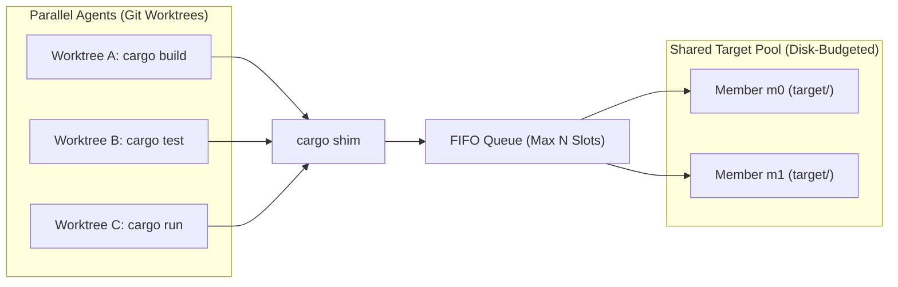
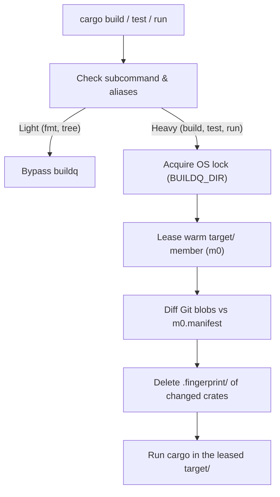

# buildq

English | [日本語](README.ja.md)

**A daemonless job queue and shared `target/` directory pool<br>for running parallel `cargo` builds across Git worktrees**

## Why buildq?

When multiple coding agents run `cargo` simultaneously across separate Git worktrees, three problems occur:

- **CPU & RAM exhaustion**
  - Concurrent Rust compilations freeze the machine
- **Disk explosion**
  - Each worktree creates its own `target/` directory (5–20 GB each)
  - Disk usage reaches dozens of gigabytes within an hour
- **Unsafe naive sharing**
  - Sharing a single `CARGO_TARGET_DIR` serializes all builds on one Cargo lock
  - `mtime` differences across worktrees cause Cargo to silently reuse stale binaries

`buildq` sits behind a transparent `cargo` shim and solves all three problems.
It requires no background daemon.



### Key Features

- **Transparent `cargo` shim**
  - Intercepts heavy commands (`build`, `test`, `clippy`, `run`, `nextest`, etc.)
  - Passes lightweight commands (`fmt`, `metadata`, `tree`, `--version`) straight through
- **Machine-wide job queue**
  - Caps concurrent builds (default: `2`) in FIFO order with priority support
  - Uses OS file locks (`flock` / `LockFileEx`) with no background daemon
  - Releases locks automatically if a process crashes or is killed
- **Safe shared `target/` pool**
  - Shares a small pool of `target/` directories across all worktrees of a repository
  - Tracks file content via Git blob hashes
  - Invalidates only modified packages before each build
- **Automatic disk budget & GC**
  - Prunes stale incremental sessions and unused artifacts in the background
  - Reclaims idle caches toward a configurable disk budget (default: `60 GB`)
- **Staged `cargo run`**
  - Copies compiled binaries and DLLs to an isolated run directory before execution
  - Prevents running executables from locking the shared `target/` directory on Windows
- **Remote execution over SSH**
  - Offloads builds to remote machines using lightweight, incremental Git snapshots

### Performance & Impact

Measured with **three Bevy worktrees building at once**.
Shared-cache reuse reduces build time and resource usage.


<details>
<summary>Measurements and environment</summary>

| Metric | Plain Cargo<br>Independent targets | buildq<br>Shared pool |
| :--- | ---: | ---: |
| Build time | 165.14 s | 120.80 s |
| Peak RSS | 4.37 GiB | 2.89 GiB |
| Allocated target disk space | 3.21 GiB | 2.14 GiB |

- Bevy 0.16.1: PBR, PNG, multithreading
- Linux x86_64, Rust 1.89.0
- 4-CPU quota, 16 GiB RAM, 2 Cargo jobs per build
- buildq: 2 slots, at most 2 pool members
- All caches initially empty
- Measured on 2026-10-23

</details>

[Methodology, additional results, and caveats](docs/benchmarks/bevy-2026-10-23.md)

## Installation

### 1. Install the binary

```sh
cargo install --git https://github.com/r4ai/buildq
```

### 2. Install the `cargo` shim

Create a directory for the shim and place it **first** on your `PATH`:

**macOS / Linux**
```sh
buildq shim install cargo --into ~/.local/share/buildq/bin
export PATH="$HOME/.local/share/buildq/bin:$PATH"
```

**Windows (PowerShell)**
```powershell
buildq shim install cargo --into C:\bq\bin
$env:PATH = "C:\bq\bin;$env:PATH"
```

> [!TIP]
> Running multiple sandboxed agents? Set `BUILDQ_DIR` and `BUILDQ_CACHE` to a shared writable directory.
> See the [Multi-Agent Sandbox Recipe](docs/development.md#multi-agent-sandbox-recipe) for details.

## Usage

### Everyday Use

Once the shim is on your `PATH`, run `cargo` commands as usual:

```sh
cargo build
cargo test
cargo run
```

`buildq` automatically queues heavy commands and prints the leased pool member:

```text
buildq: target <pool>/m0 (...)
```

### CLI Commands

| Command | Description |
| :--- | :--- |
| `buildq status [--hosts]` | Show active slot holders and waiting jobs per class |
| `buildq top` | Live jobs, wait durations, remote status, and target pool usage |
| `buildq history [-n N]` | Show recent jobs<br>(wait time, run time, exit code, pool member) |
| `buildq cache ls [--refresh]` | Show target pools, member sizes, budget, and free space |
| `buildq gc [--dry-run]` | Manually prune caches to fit within the disk budget |
| `buildq config` | Print effective configuration and directory paths |
| `buildq run [-p PRIO] -- <cmd>...` | Queue any arbitrary command (with optional priority) |
| `buildq run --host <H> -- <cmd>...` | Run a queued command on a remote SSH host |

### Configuration (`config.toml`)

All settings are optional. Place `config.toml` in `$BUILDQ_DIR/config.toml`;
use `buildq config` to find the default path.

```toml
slots = 2          # Maximum concurrent builds

[cache]
budget = "45G"     # Shared cache disk budget
min_free = "25G"   # Free-space target for the volume
```

See the [Usage Guide](docs/usage.md) for configuration options, monitoring, and SSH remote builds.

## How It Works



1. **OS File-Locked Queue**
   - Caps concurrency and automatically releases locks when a process exits
2. **Content-Based Cache Invalidation**
   - Compares Git blobs and rebuilds changed packages
3. **Two-Phase `cargo run`**
   - Stages the executable separately and releases compilation slots before launch

## Documentation

- [Usage Guide](docs/usage.md): configuration, monitoring, and SSH remote builds
- [Architecture & Internals](docs/architecture.md): queue, cache invalidation, GC, and remote protocol
- [Development & Setup Guide](docs/development.md): tests, sandbox setup, environment variables, and releases

## License

Dual-licensed under MIT or Apache-2.0 ([LICENSE-MIT](LICENSE-MIT) / [LICENSE-APACHE](LICENSE-APACHE))
