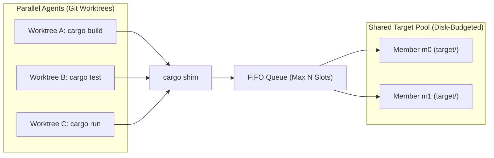
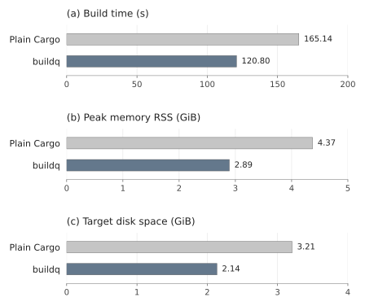
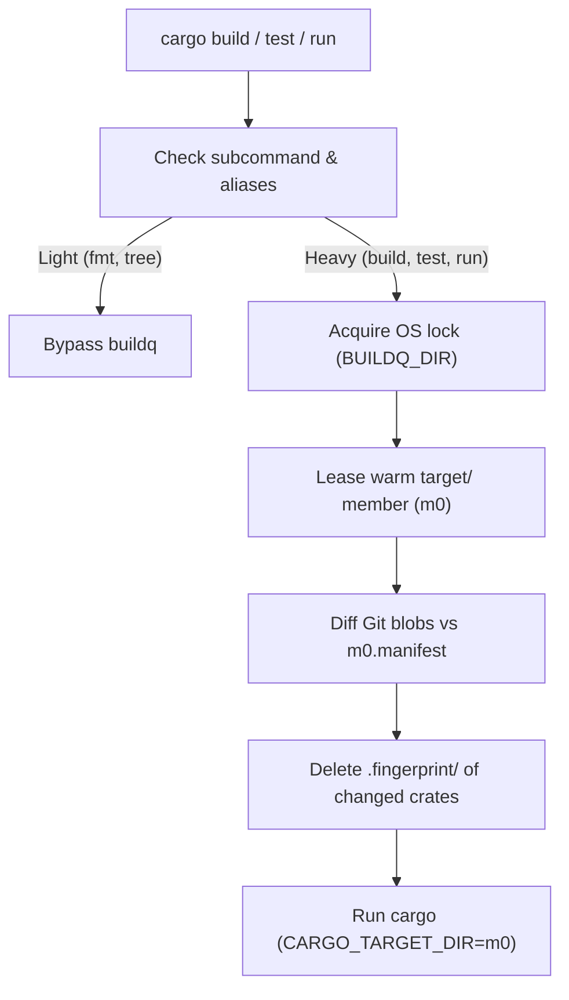

# buildq

English | [日本語](README.ja.md)

**A daemonless job queue and shared `target/` directory pool<br>for running parallel `cargo` builds across Git worktrees**

## Why buildq?

When multiple coding agents run `cargo` simultaneously across separate Git worktrees, three problems occur:

- **CPU & RAM exhaustion**
  - Concurrent Rust compilations freeze the machine
- **Disk explosion**
  - Each worktree creates its own `target/` directory (5–20 GB each)
  - Disk usage reaches dozens of gigabytes within an hour
- **Unsafe naive sharing**
  - Sharing a single `CARGO_TARGET_DIR` serializes all builds on one Cargo lock
  - `mtime` differences across worktrees cause Cargo to silently reuse stale binaries

`buildq` sits behind a transparent `cargo` shim and solves all three problems.
It requires no background daemon.



### Key Features

- **Transparent `cargo` shim**
  - Intercepts heavy commands (`build`, `test`, `clippy`, `run`, `nextest`, etc.)
  - Passes lightweight commands (`fmt`, `metadata`, `tree`, `--version`) straight through
- **Machine-wide job queue**
  - Caps concurrent builds (default: `2`) in FIFO order with priority support
  - Uses OS file locks (`flock` / `LockFileEx`) with no background daemon
  - Releases locks automatically if a process crashes or is killed
- **Safe shared `target/` pool**
  - Shares a small pool of `target/` directories across all worktrees of a repository
  - Tracks file content via Git blob hashes
  - Invalidates only modified packages before each build
- **Automatic disk budget & GC**
  - Prunes stale incremental sessions and unused artifacts in the background
  - Keeps total cache size under a configurable disk budget (default: `60 GB`)
- **Lock-free `cargo run`**
  - Copies compiled binaries and DLLs to an isolated run directory before execution
  - Prevents running executables from locking the shared `target/` directory on Windows
- **Remote execution over SSH**
  - Offloads builds to remote machines using lightweight, incremental Git snapshots

### Performance & Impact

Measured with **three Bevy worktrees building at once**.
Shared-cache reuse reduces build time and resource usage.



<details>
<summary>Measurements and environment</summary>

| Metric | Plain Cargo<br>Independent targets | buildq<br>Shared pool |
| :--- | ---: | ---: |
| Build time | 165.14 s | 120.80 s |
| Peak RSS | 4.37 GiB | 2.89 GiB |
| Allocated target disk space | 3.21 GiB | 2.14 GiB |

- Bevy 0.16.1: PBR, PNG, multithreading
- Linux x86_64, Rust 1.89.0
- 4-CPU quota, 16 GiB RAM, 2 Cargo jobs per build
- buildq: 2 slots, at most 2 pool members
- All caches initially empty
- Measured on 2026-10-23

</details>

[Methodology, additional results, and caveats](docs/benchmarks/bevy-2026-10-23.md)

## Installation

### 1. Install the binary

```sh
cargo install --git https://github.com/r4ai/buildq
```

### 2. Install the `cargo` shim

Create a directory for the shim and place it **first** on your `PATH`:

**macOS / Linux**
```sh
buildq shim install cargo --into ~/.local/share/buildq/bin
export PATH="$HOME/.local/share/buildq/bin:$PATH"
```

**Windows (PowerShell)**
```powershell
buildq shim install cargo --into C:\bq\bin
$env:PATH = "C:\bq\bin;$env:PATH"
```

> [!TIP]
> Running multiple sandboxed agents? Set `BUILDQ_DIR` and `BUILDQ_CACHE` to a shared writable directory.
> See the [Multi-Agent Sandbox Recipe](docs/development.md#multi-agent-sandbox-recipe) for details.

## Usage

### Everyday Use

Once the shim is on your `PATH`, run `cargo` commands as usual:

```sh
cargo build
cargo test
cargo run
```

`buildq` automatically queues heavy commands and prints the leased pool member:

```text
buildq: target <pool>/m0 (...)
```

### CLI Commands

| Command | Description |
| :--- | :--- |
| `buildq status [--hosts]` | Show active slot holders and waiting jobs per class |
| `buildq top [--interval SECONDS] [--iterations N]` | Live queue, wait times, remote hosts, and target pool usage |
| `buildq history [-n N]` | Show recent jobs<br>(wait time, run time, exit code, pool member) |
| `buildq cache ls [--refresh]` | Show target pools, member sizes, budget, and free space |
| `buildq gc [--dry-run]` | Manually prune caches to fit within the disk budget |
| `buildq config` | Print effective configuration and directory paths |
| `buildq run [-p PRIO] -- <cmd>...` | Queue any arbitrary command (with optional priority) |
| `buildq run --host <H> -- <cmd>...` | Run a queued command on a remote SSH host |

`buildq top` refreshes every 2 seconds on a terminal; press Ctrl+C to quit.
Redirected output prints one snapshot. Use `--iterations N` for a finite number
of updates. Remote host checks run in the background during live updates.
Pool sizes use the same cached measurements as `buildq cache ls`.

### Configuration (`config.toml`)

All settings are optional.
Place `config.toml` in `$BUILDQ_DIR/config.toml` (check `buildq config` for the default path on your OS):

```toml
slots = 2                # Max concurrent build jobs (default: 2)
# max_per_worktree = 1   # Soft cap per worktree in each class (default: ceil(slots / 2); 0 disables)
run_slots = 2            # Max concurrent app runs for `cargo run` (default: 2)

[cache]
max_members = 3          # Max target/ dirs per repo+toolchain (default: slots + 1)
budget = "45G"           # Max disk usage under BUILDQ_CACHE (default: "60G")
min_free = "25G"         # Minimum free disk space to preserve on volume (default: "20G")
# pool_explicit = true   # Also pool explicit --target-dir / CARGO_TARGET_DIR inside the worktree (default: false)

[cargo]
rustc_wrapper = "none"   # Disable global sccache per job ("none" | "keep" | "/path")
# jobs = 8               # CARGO_BUILD_JOBS per build (default: cores / slots)
```

| Setting | Environment override | Default |
| :--- | :--- | :--- |
| `max_per_worktree` | `BUILDQ_MAX_PER_WORKTREE` | `ceil(slots / 2)`; `0` disables |

The cap applies separately within each job class, using the Git worktree root
(or the current directory outside Git) as identity.
When another worktree is queued below its cap, its tickets precede tickets
from worktrees already at their cap.
Within each group, higher priority runs first, then strict FIFO.
When all waiting worktrees are at their cap, jobs can still use idle slots.
`buildq status` marks deferred tickets with `waiting: worktree cap`.
Nested calls using `BUILDQ_HELD` remain exempt.

### Remote Builds (SSH)

Add remote hosts to `config.toml` to offload builds over SSH and Git:

```toml
[hosts.box]
ssh = "box"              # Host alias from ~/.ssh/config
slots = 4                # Max concurrent jobs sent to this host

auto_hosts = ["local", "box"]
```

Run commands on a specific host or let `buildq` pick one automatically:

```sh
buildq run --host box -- cargo test
buildq run --host auto -- cargo clippy --all-targets
buildq run --host box --fetch target/debug/app -- cargo build --bin app
```

## How It Works



1. **OS File-Locked Queue**
   - Exclusive OS file locks (`flock` / `LockFileEx`) in `$BUILDQ_DIR`
   - Automatic lock release on process crash or kill—no stale locks
   - Deadlock-free nested `cargo` calls via `BUILDQ_HELD` detection
2. **Content-Addressed Manifest Invalidation**
   - Cross-worktree artifact reuse via Cargo's workspace-relative path hashing
   - Per-file Git blob tracking in `m0.manifest`
   - Targeted `.fingerprint/<pkg>-*` deletion for modified packages before each build
   - On source-root changes, invalidate every local package so `CARGO_MANIFEST_DIR` and other compiled paths refer to the current worktree
   - Registry/git dependencies stay shared; same-root builds keep normal incremental reuse
   - Fast, accurate incremental rebuilds independent of file `mtime`
3. **Two-Phase `cargo run`**
   - Phase 1: Compile under a `build` slot and copy the binary + DLLs to `runs/r0`
   - Phase 2: Release the `build` slot and `target/` member, then launch the binary under a `run` slot
   - Zero `target/` locking while applications are running

## Documentation

- **[Architecture & Internals](docs/architecture.md)**
  - Queue lock design, manifest invalidation invariant, and member selection scoring
  - 5-stage GC, remote SSH protocol, design alternatives, and limitations
- **[Development & Setup Guide](docs/development.md)**
  - Codebase layout and running unit / E2E tests
  - Multi-agent sandbox setup and environment variables

## Releases

Rust edition 2024, MSRV 1.89; CI and releases use Rust 1.99.0 from
`rust-toolchain.toml`. Toolchain updates must keep both CI versions green.
CI checks formatting, strict Clippy, docs, dependencies, and real Cargo E2E
on Linux, macOS, and Windows. Dependencies use weekly grouped Dependabot
updates with a seven-day cooldown; security updates should be reviewed promptly.

1. Update `package.version` in `Cargo.toml` and refresh `Cargo.lock` with
   `cargo update`; merge the reviewed change into `main` after CI passes
2. Tag that commit (`git tag -a v0.1.0 -m "Release v0.1.0"`) and push the tag
   (`git push origin v0.1.0`), replacing the example version as needed
3. The tag workflow reruns CI, checks the version and `main` ancestry, builds
   Linux/macOS x86_64 and aarch64 plus Windows x86_64 binaries, and publishes
   archives, licenses, `SHA256SUMS`, and GitHub-generated release notes

Prerelease tags such as `v0.2.0-rc.1` require the same version in `Cargo.toml`
and create prereleases. Provenance is attached to every archive; verify it with
`gh attestation verify ARCHIVE --repo r4ai/buildq`, and verify downloads with
`sha256sum -c SHA256SUMS` (macOS: `shasum -a 256 -c SHA256SUMS`).
Publication starts as a draft and becomes public only after all assets upload.
If publication fails after draft creation, inspect/delete that draft before
rerunning the failed job; never move a published tag.

Maintainers must allow GitHub Actions and artifact attestations, enable Dependabot
security updates and private vulnerability reporting, require **CI passed** in the
`main` ruleset, and restrict `v*` tag creation/update/deletion to release maintainers.
The public-repository workflow uses only `GITHUB_TOKEN` and GitHub OIDC; no personal
access token or signing secret is needed. See [Security policy](SECURITY.md).

## License

Dual-licensed under MIT or Apache-2.0 ([LICENSE-MIT](LICENSE-MIT) / [LICENSE-APACHE](LICENSE-APACHE))
