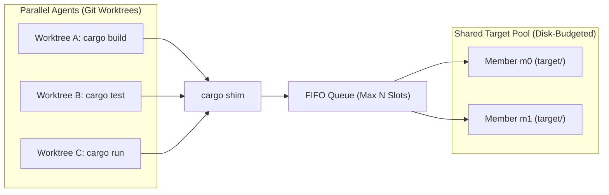
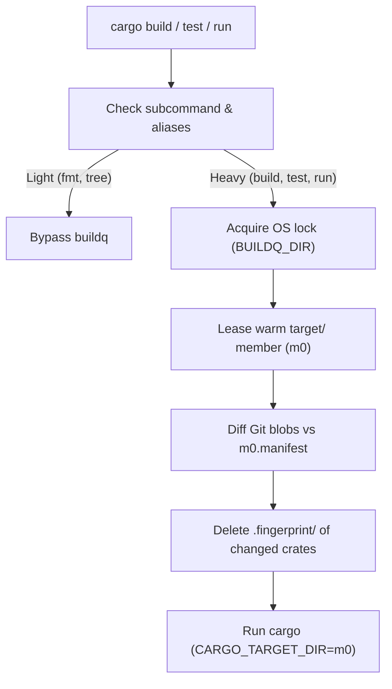

# buildq

English | [日本語](README.ja.md)

**A daemonless job queue and shared `target/` directory pool<br>for running parallel `cargo` builds across Git worktrees**

---

## Why buildq?

When multiple coding agents run `cargo` simultaneously across separate Git worktrees, three problems occur:

- **CPU & RAM exhaustion**
  - Concurrent Rust compilations freeze the machine
- **Disk explosion**
  - Each worktree creates its own `target/` directory (5–20 GB each)
  - Disk usage reaches dozens of gigabytes within an hour
- **Unsafe naive sharing**
  - Sharing a single `CARGO_TARGET_DIR` serializes all builds on one Cargo lock
  - `mtime` differences across worktrees cause Cargo to silently reuse stale binaries

`buildq` sits behind a transparent `cargo` shim and solves all three problems.
It requires no background daemon.



### Key Features

- **Transparent `cargo` shim**
  - Intercepts heavy commands (`build`, `test`, `clippy`, `run`, `nextest`, etc.)
  - Passes lightweight commands (`fmt`, `metadata`, `tree`, `--version`) straight through
- **Machine-wide job queue**
  - Caps concurrent builds (default: `2`) in FIFO order with priority support
  - Uses OS file locks (`flock` / `LockFileEx`) with no background daemon
  - Releases locks automatically if a process crashes or is killed
- **Safe shared `target/` pool**
  - Shares a small pool of `target/` directories across all worktrees of a repository
  - Tracks file content via Git blob hashes
  - Invalidates only modified packages before each build
- **Automatic disk budget & GC**
  - Prunes stale incremental sessions and unused artifacts in the background
  - Keeps total cache size under a configurable disk budget (default: `60 GB`)
- **Lock-free `cargo run`**
  - Copies compiled binaries and DLLs to an isolated run directory before execution
  - Prevents running executables from locking the shared `target/` directory on Windows
- **Remote execution over SSH**
  - Offloads builds to remote machines using lightweight, incremental Git snapshots

### Performance & Impact

| Metric | Per-worktree<br>`target/` | Naive shared<br>`CARGO_TARGET_DIR` | `buildq` |
| :--- | :--- | :--- | :--- |
| **CPU / RAM usage** | Unbounded<br>(machine freezes) | Serialized<br>(1 build at a time) | **Bounded to `N` builds** |
| **2nd worktree<br>1st build** | `11.2 s`<br>(8 crates compiled) | `1.4 s`<br>(0 crates compiled) | **`1.4 s`<br>(0 crates compiled)** |
| **Edit file with<br>older `mtime`** | Safe: `4.3 s`<br>(3 crates compiled) | **Broken**<br>(runs stale code) | **Safe: `4.3 s`<br>(3 crates compiled)** |
| **Disk usage<br>(`W` worktrees)** | `W × 110 MiB`<br>(grows linearly) | `1 × 113 MiB` | **`≤ slots × 113 MiB`<br>(capped by budget)** |

> Measured on a sample workspace (`regex` + 3 workspace crates) across two Git worktrees on Windows 11.
> `buildq` adds ~0.4–0.6 s of overhead per queued build.

---

## Installation

### 1. Install the binary

```sh
cargo install --git https://github.com/r4ai/buildq
```

### 2. Install the `cargo` shim

Create a directory for the shim and place it **first** on your `PATH`:

**macOS / Linux**
```sh
buildq shim install cargo --into ~/.local/share/buildq/bin
export PATH="$HOME/.local/share/buildq/bin:$PATH"
```

**Windows (PowerShell)**
```powershell
buildq shim install cargo --into C:\bq\bin
$env:PATH = "C:\bq\bin;$env:PATH"
```

> [!TIP]
> Running multiple sandboxed agents? Set `BUILDQ_DIR` and `BUILDQ_CACHE` to a shared writable directory.
> See the [Multi-Agent Sandbox Recipe](docs/development.md#multi-agent-sandbox-recipe) for details.

---

## Usage

### Everyday Use

Once the shim is on your `PATH`, run `cargo` commands as usual:

```sh
cargo build
cargo test
cargo run
```

`buildq` automatically queues heavy commands and prints the leased pool member:

```text
buildq: target <pool>/m0 (...)
```

### CLI Commands

| Command | Description |
| :--- | :--- |
| `buildq status [--hosts]` | Show active slot holders and waiting jobs per class |
| `buildq history [-n N]` | Show recent jobs<br>(wait time, run time, exit code, pool member) |
| `buildq cache ls [--refresh]` | Show target pools, member sizes, budget, and free space |
| `buildq gc [--dry-run]` | Manually prune caches to fit within the disk budget |
| `buildq config` | Print effective configuration and directory paths |
| `buildq run [-p PRIO] -- <cmd>...` | Queue any arbitrary command (with optional priority) |
| `buildq run --host <H> -- <cmd>...` | Run a queued command on a remote SSH host |

### Configuration (`config.toml`)

All settings are optional.
Place `config.toml` in `$BUILDQ_DIR/config.toml` (check `buildq config` for the default path on your OS):

```toml
slots = 2                # Max concurrent build jobs (default: 2)
run_slots = 2            # Max concurrent app runs for `cargo run` (default: 2)

[cache]
max_members = 3          # Max target/ dirs per repo+toolchain (default: slots + 1)
budget = "45G"           # Max disk usage under BUILDQ_CACHE (default: "60G")
min_free = "25G"         # Minimum free disk space to preserve on volume (default: "20G")

[cargo]
rustc_wrapper = "none"   # Disable global sccache per job ("none" | "keep" | "/path")
# jobs = 8               # CARGO_BUILD_JOBS per build (default: cores / slots)
```

### Remote Builds (SSH)

Add remote hosts to `config.toml` to offload builds over SSH and Git:

```toml
[hosts.box]
ssh = "box"              # Host alias from ~/.ssh/config
slots = 4                # Max concurrent jobs sent to this host

auto_hosts = ["local", "box"]
```

Run commands on a specific host or let `buildq` pick one automatically:

```sh
buildq run --host box -- cargo test
buildq run --host auto -- cargo clippy --all-targets
buildq run --host box --fetch target/debug/app -- cargo build --bin app
```

---

## How It Works



1. **OS File-Locked Queue**
   - Exclusive OS file locks (`flock` / `LockFileEx`) in `$BUILDQ_DIR`
   - Automatic lock release on process crash or kill—no stale locks
   - Deadlock-free nested `cargo` calls via `BUILDQ_HELD` detection
2. **Content-Addressed Manifest Invalidation**
   - Cross-worktree artifact reuse via Cargo's workspace-relative path hashing
   - Per-file Git blob tracking in `m0.manifest`
   - Targeted `.fingerprint/<pkg>-*` deletion for modified packages before each build
   - Fast, accurate incremental rebuilds independent of file `mtime`
3. **Two-Phase `cargo run`**
   - Phase 1: Compile under a `build` slot and copy the binary + DLLs to `runs/r0`
   - Phase 2: Release the `build` slot and `target/` member, then launch the binary under a `run` slot
   - Zero `target/` locking while applications are running

---

## Documentation

- **[Architecture & Internals](docs/architecture.md)**
  - Queue lock design, manifest invalidation invariant, and member selection scoring
  - 5-stage GC, remote SSH protocol, design alternatives, and limitations
- **[Development & Setup Guide](docs/development.md)**
  - Codebase layout and running unit / E2E tests
  - Multi-agent sandbox setup and environment variables

## License

Dual-licensed under MIT or Apache-2.0 ([LICENSE-MIT](LICENSE-MIT) / [LICENSE-APACHE](LICENSE-APACHE))
