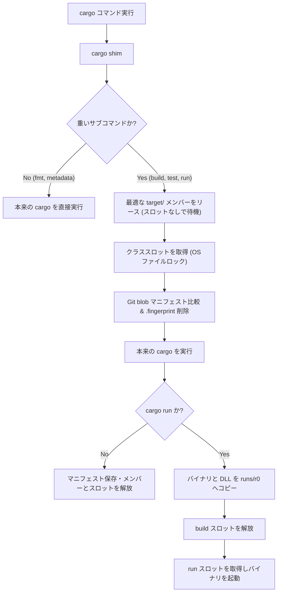
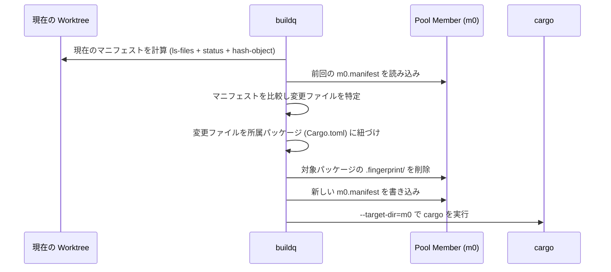

# Architecture & Internals

[English](architecture.md) | 日本語

本ドキュメントでは `buildq` の内部設計について解説する。
ファイルロックベースのジョブキュー、コンテンツアドレス型の `target/` 共有プール、ガベージコレクション、SSH リモート実行プロトコルを扱う。



## 1. Daemonless Queue

`buildq` はバックグラウンドデーモンを持たず、プレーンファイルと OS レベルのファイルロックのみで動作する。
すべてのプロセス（および各エージェントのサンドボックス）は、共有ディレクトリ（`$BUILDQ_DIR`）を介して協調する。

### Directory Layout

```text
$BUILDQ_DIR/<class>/
  queue.lock                           # キュー投入・スロット割当用の短いクリティカルセクション
  seq                                  # 単調増加するチケット番号（現在時刻 ms が下限）
  slot-<i>.lock / slot-<i>.json        # スロット i を保持中のジョブのロックとメタデータ
  tickets/t-<seq>-<pid>.lock / .json   # 待機中ジョブごとのロックとメタデータ
```

### Locking & Crash Safety

- すべてのロックに OS ファイルロックを使用（Windows は `LockFileEx`、Unix は `flock`）
- ロックの生存期間はオープン中のファイルディスクリプタに紐づく
  - プロセスがクラッシュ・強制終了すると、OS がスロットとチケットのロックを即座に自動解放
  - ロック取得可能なチケットは死んだプロセスとみなされ、自動的に掃除される
  - ロック取得可能なスロットは空きスロットとして扱われる

### Scheduling & Priority

- 待機プロセスは一定間隔（デフォルト `250 ms`、`poll_ms` で変更可）でポーリングを実行
- `queue.lock` 保持下で生存チケットを worktree 上限でグループ分けし、各グループを `(priority DESC, seq ASC)` 順にソート
- 自身の順位が「現在の空きスロット数」未満のときのみ、空きスロットを取得
- 同一グループ・同一優先度内では厳密な FIFO 順を保証
- 高優先度ジョブは待機中ジョブを追い越すが、実行中ジョブをプリエンプトしない

上限はジョブクラスごとに適用する。識別には Git worktree のルートを使い、Git 外では現在のディレクトリを使う。
上限未満の別 worktree が待機している場合、そのチケットを上限到達済みの worktree より先に割り当てる。
各グループ内では優先度順、同一優先度では FIFO 順である。
全待機 worktree が上限に達している場合も、空きスロットは利用できる。
`buildq status` は延期中のチケットに `waiting: worktree cap` を表示する。
`BUILDQ_HELD` による入れ子呼び出しは対象外である。

### Job Classes & Nesting

- クラスごとに独立したスロットプールを保持
  - `build`: コンパイル用スロット（デフォルト: `slots = 2`）
  - `run`: アプリ実行用スロット（デフォルト: `run_slots = 2`）
  - `host-<name>`: 特定の SSH リモートホストへ送るジョブ用スロット
  - `[classes]` で定義されたカスタムクラス（例: `gpu = 1`）
- **デッドロック防止**
  - 実行中ジョブは子プロセスへ環境変数 `BUILDQ_HELD=<保持中クラス>` を引き継ぐ
  - ネストされた `buildq` や `cargo` shim は、対象クラスが `BUILDQ_HELD` に含まれていればキューをバイパスして即時実行
  - 入れ子呼び出しが祖先の保持するキュースロットを再取得しない

### Nested Cargo

組み込みのコンパイルコマンドと clippy には、プールの target を `--target-dir` で渡す。
親のロック済み target を helper に強制しないよう、buildq は `CARGO_TARGET_DIR` を新たにエクスポートしない。
別ワークスペースの helper は通常の target を使い、さらに入れ子の helper も独立して選択する。
明示的な利用者の環境変数は保持する。

ソースマニフェスト内の別 Cargo.toml の隣に見つかった通常の target は、外部容量のレジストリに記録する。
プール予算の管理対象外であり、GC は削除しない。
Cargo 設定による任意の別パスは、この探索では推測しない。
`OUT_DIR` 配下を helper の `--target-dir` に指定すれば、親メンバー内で容量とロックを管理できる。

カスタム Cargo plugin は CLI の互換性を保つため、環境変数による target 指定を継続する。
plugin 内の helper は独立した target を明示する必要がある。
同じワークスペースを再帰的にビルドする場合の Cargo 自身のロック制約は残る。
`BUILDQ_HELD` が防ぐのはキューの再取得だけである。

### Process Tree & Signal Handling

- 子プロセス実行中、`buildq` 自身は `Ctrl+C` を無視（コンソールから子へ直接届く）し、子の終了コードをそのまま返す
- **Windows**
  - 子プロセスを kill-on-close 設定の Job Object 内で実行（デフォルト `kill_tree = true`）
  - `buildq` が強制終了されると、コンパイラのプロセスツリー全体も即座に終了
  - 解放されたスロットの裏でビルドが残留して走り続ける事態を防止
- **Unix**
  - `SIGTERM` および `SIGHUP` を子プロセスへ転送
  - 監視プロセス（`buildq __watch`）がスロットとプールメンバーのロックを引き継いで保持
  - `buildq` が先に終了すると（`SIGKILL` でも）、監視プロセスが子のプロセスツリーを終了させてから（`kill_tree = false` なら子の終了を待ってから）ロックを解放

## 2. Shared `target/` Pool

### Directory Layout

```text
$BUILDQ_CACHE/
  pools/<repo>-<hash(repo, toolchain)>/
    pool.json                 # リポジトリ共通 git dir とツールチェイン (rustc -vV)
    pool.lock                 # メンバー選択用の短いクリティカルセクション
    m<i>/                     # 実際の cargo target ディレクトリ (--target-dir)
    m<i>.lock                 # メンバー i を使用中のジョブが保持する排他ロック
    m<i>.json                 # 最終使用時刻・最終 worktree・サイズ・累計ジョブ数
    m<i>.manifest             # 相対ファイルパス -> Git blob ID の対応表
  runs/r<i>/ (+ .lock/.json)  # `cargo run` 用の分離実行ディレクトリ
  trash/                      # 非同期削除用に退避されたディレクトリ
```

- **プール単位**: 同一 Git リポジトリ（`git rev-parse --git-common-dir`）かつ同一ツールチェイン（`rustc -vV`）の全 worktree を1つのプールに集約
- **メンバー数**: 1プールあたり最大 `max_members` 個の `target/` ディレクトリ（`m0`, `m1`, ...）を保持
- **排他リース**: 各ビルドジョブは1つのメンバーを実行完了まで排他リース（並列ビルドには最低 `slots` 個のメンバーが必要）
- **リースが先、スロットが後**: ビルドはメンバーを先に、ビルドスロットを後に取得する。使用中のメンバー（例: ネイティブアプリが保持）を待つジョブはマシン全体の容量を占有せず、無関係なリポジトリのビルドは進行できる。スロット保持者がメンバーを待つことはないため、この順序でデッドロックしない

### Why Naive Sharing Fails

Cargo は成果物に `<crate>-<hash>` という名前を付ける。
ワークスペース内のクレートでは、このハッシュ計算に**ワークスペースルートからの相対パス**が使われる。
そのため、`crates/core` のハッシュはどの Git worktree でも完全に一致し、成果物をそのまま再利用できる。

しかし、`CARGO_TARGET_DIR` を単純共有すると以下の問題が起きる。
- Cargo はファイルの更新日時（`mtime`）の大小で再ビルド要否を判定
- Worktree A が `12:05` に `crates/core` をビルドしたとする
- Worktree B には、それより前の `12:00` に編集・チェックアウトされた `crates/core/src/lib.rs` があるとする
- Worktree B が同じ `target/` でビルドすると、Cargo は「成果物（`12:05`）がソース（`12:00`）より新しい」と判定し、**Worktree A の古いコードを黙って再利用してしまう**

### The Fix: Git Blob Manifests & Fingerprint Invalidation

`buildq` はタイムスタンプではなく、ファイル内容のハッシュ（Git blob ID）を追跡することでこの問題を解決する。
各メンバーは「どのファイル内容から成果物が作られたか」を `m<i>.manifest` に記録する。



メンバー `m<i>` でビルドを開始する前の手順：

1. **現在の Worktree 状態をスナップショット**
   - `git ls-files -s` と `git status` を実行
   - 変更ファイル・未追跡ファイルを `git hash-object` でハッシュ化（gitignore 対象は除外）
   - index がキャッシュした stat 情報と ctime・mtime・inode・サイズ（ナノ秒精度）が異なる追跡ファイルもハッシュ化する。Git は秒単位で比較するため、mtime を保ったままのサイズが同じ編集を clean と判定することがある
   - 初期化済みサブモジュールは gitlink の代わりにサブモジュール自身のマニフェストを再帰的に展開し、サブモジュール内の path 依存も内容で比較
   - Worktree の外（または Git が無視するディレクトリ）にある path 依存はマニフェストに含まれず、鮮度判定は Cargo の mtime 比較だけに頼る。ジョブはそれらを note で列挙する
2. **メンバーのマニフェストと差分比較**
   - 現在のマニフェストと `m<i>.manifest` を比較
   - 内容が異なる各ファイルを、最も近い親ディレクトリの `Cargo.toml`（`[package]` を持つもの）に紐づけ
3. **Fingerprint の削除**
   - `m<i>` 内の全プロファイル・全ターゲットから、該当パッケージの `.fingerprint/<pkg>-*` を削除
   - これにより `mtime` の新旧にかかわらず、Cargo は該当パッケージと依存先を確実に再ビルド
   - `rustc` のインクリメンタルキャッシュは残るため、再ビルド自体は差分で高速に完了
4. **マニフェストの更新**
   - 現在のマニフェストを `m<i>.manifest` として保存

**安全性の不変条件**:
メンバー `m<i>` 内のすべてのパッケージについて、「`.fingerprint` が存在しない」か「成果物が `m<i>.manifest` の内容と一致する」のいずれかが常に成り立つ。
ビルド実行前に無効化を行いロールバックしないため、部分ビルド（`-p foo`）・ビルド失敗・強制終了が起きてもこの不変条件は崩れない。

ソースルートが変わる場合は全ローカルパッケージを無効化する。
`CARGO_MANIFEST_DIR` などの埋め込みパスを現在の worktree に更新するためである。
registry／git 依存のキャッシュは共有し、同一ルートでは通常のインクリメンタルビルドを維持する。

### Member Selection Algorithm

`pool.lock` 保持下で、すべての空きメンバーを以下のタプルでスコアリングする。

```text
(未ビルドか, 再ビルド対象パッケージ数, 差分ファイル数, 別 worktree での最終使用か, 最終使用時刻の古さ)
```

再ビルド対象は、無効化するパッケージと、それらに推移的に依存する workspace パッケージの和集合である。
`cargo metadata --no-deps --offline` から依存関係を取得し、共通の依存元は1回だけ数える。
optional・build・dev・ターゲット固有の依存関係も保守的に含める。
これはコンパイル時間ではなく、再ビルド対象パッケージ数の推定である。
メタデータを取得できない場合は無効化パッケージ数にフォールバックする。
ソースルートが変わる場合は、スコアリング前にすべてのローカルパッケージを無効化対象にする。

スコアが最小のメンバーが選ばれる。
1. ビルド済みで再ビルド対象パッケージ数が最小のメンバーを優先
2. 同点の場合は差分ファイル数、worktree の一致、使用時刻の新しさで選択
3. 全メンバーが使用中かつ `max_members` 未満であり、ディスク予算に余裕がある場合のみ新規メンバーを作成

## 3. Two-Phase `cargo run`

ビルド前に Cargo metadata を使い、実行するパッケージとターゲットを一意に決定する。
既定メンバー、マニフェスト、パッケージ、bin、example、default-run の指定を反映する。
曖昧な場合はビルドスロットの取得やアプリ起動を行わず、終了コード `101` を返す。
成果物メッセージも、そのパッケージ・ターゲット名・種別に一致するもののみを実行対象にする。

Windows では実行中の `.exe` ファイルが OS によってロックされる。
共有 `target/` 内のバイナリを直接起動すると、アプリ終了までそのメンバーでの後続ビルドがすべて失敗する。

そのため、`buildq` は `cargo run`（および `run` に解決されるエイリアス）を2つのフェーズに分割する。

1. **ビルドフェーズ**（メンバー `m<i>`、次に `build` スロットを保持）
   - `--message-format=json-render-diagnostics` と対象の `--bin` を付与して `cargo build` を実行
   - JSON メッセージから実行ファイル・DLL / 共有ライブラリ・`.pdb`・リンクパスを特定
   - サイズまたは `mtime` が変化したファイルのみを `$BUILDQ_CACHE/runs/r<j>` へ差分コピー
2. **実行フェーズ**（`run` スロットを保持、`build` スロットは解放済み）
   - 呼び出し元のカレントディレクトリを維持したまま、`runs/r<j>` 内のバイナリを実行
   - `PATH` / `LD_LIBRARY_PATH`、`CARGO_MANIFEST_DIR`、`CARGO_PKG_*` を `cargo run` と同様に設定（Bevy の `assets/` 等もそのまま動作）

ネイティブ共有ライブラリがメンバー内に残る場合は、run 待機中からアプリ終了までメンバーの排他リースを保持する。
ビルド出力・リンク検索先・profile/deps の共有ライブラリを調べ、コピー済みの Rust ライブラリは除外する。
絶対パス参照や遅延ロードを壊さないため、依存するメンバーを使用中として GC から保護する。
ビルドスロットは解放するが、利用できるプールメンバー数は減る。
この容量は使用中データとして計上し、アプリ終了後にリースを解放して GC を再試行する。

ホーム・祖先ディレクトリ・`--config` の Cargo `[env]` を適用する。
`force` と設定ファイル基準の相対パスにも対応する。

実行フェーズは、選択したビルドターゲットの Cargo runner を使用する。
ターゲットトリプルの設定を `cfg(...)` の一致より優先し、複数の cfg runner が一致する場合はエラーにする。
runner の文字列・引数配列・設定ファイル基準の実行パス・環境変数・`--config` をビルド前に解決する。
runner にはコピー済み実行ファイルとアプリの引数を渡し、run スロットで実行する。

## 4. Disk Budget & Garbage Collection

プールを使用したビルドの終了後に自動 GC を実行する。
デフォルトはバックグラウンドであり、`[cache] gc_mode = "inline"` では同じプロセス内で回収する。
親側の事前判定により、直近に実行済みで予算内なら GC 子プロセスを作成しない。
GC 側でもロック取得後に再判定する。両モードとも予算超過時を除き10分に1回へ制限する。
バックグラウンドモードは Unix で子を回収する init を必要とする。
インラインモードは終了までの待ち時間を使い、GC の生存期間をジョブ内に収める。
どちらも常駐デーモンを追加しない。[Automatic GC](usage.ja.md#automatic-gc) を参照する。

キャッシュ予算は保持容量のソフトリミットである。
使用中のメンバーと実行用コピーは保護するため、実行中は一時的に超過しうる。
`cache ls --json` と `gc --json` は `over_budget`、`over_budget_bytes`、
`over_budget_reasons` を返す。テキスト出力と `top` にも警告を表示する。
GC は使用中の成果物による超過を削除失敗として扱わない。
削除失敗がなければ終了コードは成功である。

空き容量ガードが許す限り、予算を超えるビルドも完了できる。
完了メンバーが設定予算全体より大きい場合は、予算の増加や成果物の削減を促す警告を表示する。
GC は未使用になったメンバーを、唯一のメンバーでも回収しうる。
その場合、次回の呼び出しはコールドビルドになる。
サイズ診断の概算は最大60秒再利用し、初回ビルド後と実際の GC では計測する。
ウォーム状態の target をジョブごとに全走査することは避ける。

```math
\text{effective\_budget} = \min(\text{budget}, \text{used} + \text{free} - \text{min\_free})
```

### Size Accounting

`[cache] accounting = "allocated"` がデフォルトである。
Unix では割り当て済みファイルブロック（`st_blocks * 512`）、Windows ではファイルの割り当てサイズを使用する。
メンバー・実行ディレクトリ・ゴミ箱の各項目内で、デバイス／ボリュームとファイル識別子によってハードリンクの重複を除く。
シンボリックリンクとディレクトリのメタデータは含めない。
スパースファイルの未割り当て領域は、ブロックが割り当てられるまで予算を消費しない。

`accounting = "logical"` では、重複を除いたファイル長を数え、スパース領域も含める。
概算には集計基準を記録し、設定が変われば再計測する。
JSON の `accounting` とテキスト出力で集計基準を確認できる。

概算の保存と削除判断のため、集計単位は独立して扱う。
単位をまたぐハードリンクや、別の識別子が共有する reflink の領域は、それぞれの単位に保守的に計上する。
ただし、[重複排除](#cross-member-deduplication)が記録した共有は1回だけ計上する。
`freed` は計上容量の削減量であり、ボリュームの空き容量の増分そのものではない。
各アクションのサイズは対象パスの容量であり、単純には加算できない。
prune 後はメンバーを再計測し、リンクの片方だけの削除で残るファイル全体を解放したとは報告しない。
dry-run も同じ削除予定パスを除外して計算する。
削除失敗したゴミ箱の概算は集計モードごとに保持する。
権限のため再計測できない場合は、旧形式の既知概算も維持する。

### Collection Stages

GC は使用中メンバーには一切触れず、コストの低い順（5段階）で削除を進める。

1. **Trash の掃除**: `trash/` 内の削除途中ディレクトリを完全削除
2. **古いインクリメンタル・中間成果物の削除**（未使用メンバー内）
   - 各クレートの最新セッション以外のインクリメンタルキャッシュ
   - `incremental_days`（デフォルト `3` 日）以上使われていないインクリメンタルディレクトリ
   - `stale_unit_days`（デフォルト `14` 日）以上使われていない旧ハッシュの成果物（`cargo-sweep` 相当）
   - 続けて、未使用メンバー間の同一ファイルを共有（[重複排除](#cross-member-deduplication)）
3. **放置プールの削除**: `pool_idle_days`（デフォルト `21` 日）以上使われていないプール全体を削除
4. **放置 Run ディレクトリの削除**: 2日以上使われていない `runs/r<i>` を削除
5. **LRU メンバー削除**: それでも予算を超過している場合、最終使用が古いメンバーから丸ごと削除

削除に失敗した場合は残存パスとエラーを報告し、`buildq gc` は非ゼロで終了する。
解放量には実際に削除できたバイト数のみを計上する。
未削除のゴミ箱データも `cache ls` の合計と予算計算に含め、次回の GC で再試行する。
権限のため残存サイズを計測できない場合は、直前の既知サイズを概算として保持する。
GC は権限を自動変更しない。
報告されたパスの権限やファイルロックを修復した後、GC を再実行する。

自動容量検査の削除判断は次の再計測まで延期される場合がある。
`cache ls --refresh` と実際の GC 処理では再計測してから削除を判断する。

### Cross-Member Deduplication

同じツールチェーンのメンバーは、リポジトリが違っても、同じ相対パスにバイト単位で同一の registry 依存の成果物を持つことが多い。
GC は段階 2 の後に、それらを reflink として共有する。

1. **未使用メンバーの索引作成**（ロックは保持しない）
   - `dedupe_min_size`（デフォルト `64KiB`）以上のファイル
   - `incremental/` と `.fingerprint/` は対象外
   - ツールチェーン・ボリューム・相対パス・長さでグループ化
   - ツールチェーンごとに順に処理し、他にコピーがあるファイルだけを保持する。1回のパスが一度に持つのは1つのツールチェーン分のメタデータで、索引したファイル数と時間を報告する
2. **各コピーをグループの先頭コピーと共有**（両メンバーのロックを保持）
   - 索引時の inode・長さ・mtime を再確認
   - 3 つ以上のコピーがあるグループは、先頭と末尾の各 4 KiB のハッシュで先に分割する。比較が残るコピーだけを読み、`dedupe_max_read` に数え、ファイルが変わるまで `dedupe.json` に残す。ハッシュが同じコピーだけを比較するので、内容が食い違うコピーは総当たりで比較されない
   - 先頭と異なるコピーは、次に見つかった異なるコピーと比較する。内容が複数あるグループでも、内容ごとに共有できる
   - リースを妨げないよう、1 GiB または1秒ごとにロックを解放
   - Linux: `FIDEDUPERANGE`。カーネルがバイトを比較し、inode を維持する
   - macOS: バイトを比較して `clonefile` し、mode と時刻を復元してから `rename` で置き換える
3. **共有したパスを記録**（`$BUILDQ_CACHE/dedupe.json`）

**不変条件**:
どのパスの内容・長さ・mode・mtime も変更しない。
したがって fingerprint・メンバーのマニフェスト・プールの安全条件はそのまま成立する。

割り当てブロック数は clone を毎回満額で報告する。
そこで、記録した各グループのデバイス・inode・長さ・mtime・ctime がすべて一致する間は、先頭以外のコピーを使用量から差し引く。
差し引く量は、1コピーあたり長さをブロック単位に切り上げた量までとする（EOF 以降の事前割り当ては共有されないため）。
書き直されたパスは、mtime を元に戻す書き込みであってもグループから外れる。
ハードリンクの追加や削除などほかの状態変更でも外れるが、使用量を多めに見積もるだけで済む。
2回記録された inode は1回だけ数える。
メンバーの追い出しでは、残る他のメンバーと共有していない分だけを解放量として計上する。

手動の `buildq gc` とバックグラウンドの GC が実行し、自動 GC では1時間に1回までに抑える。
ジョブが完了を待つインライン GC では実行しない。
1回に読む量は `dedupe_max_read`（デフォルト `8G`）までで、次のパスは上限で止まったメンバーの組から再開する。
内容が異なると分かったコピーも記録し、どちらかのファイルが変わるまで比較を省く。
reflink 非対応のボリュームでは未対応と報告し、何も変更しない。

### Free-Space Guard

プールメンバーを借りる前に、Cargo ビルドはキャッシュのボリュームの空き容量を確認する。
`min_free` 以下なら GC を1回実行する。
空き容量が足りなければ終了コード `125` でビルドを拒否する。
空き容量の回復を待つためにスロットを保持し続けることはない。

プール内のコンパイル中は100 ms ごと、および完了時に空き容量を確認する。
検査に失敗した場合は、ビルドのプロセスツリーを停止してからスロットとメンバーを解放する。
`cargo run` はアプリを起動しない。
この停止は `kill_tree = false` でも適用する。
失敗は履歴に記録し、容量回復後の呼び出しで再試行できる。
空き容量を計測できない場合もビルドを拒否する。

この仕組みはベストエフォートの空き容量保護であり、ファイルシステムのクォータではない。
他の書き込みが検査間に容量を消費する場合はある。
`[cache] min_free = "0"` で無効化できる。
プール外のコマンドは保護対象外である。

未使用プールの回収では `pool.lock` を保持し、使用状況を再確認して全メンバーのロックを取得する。
成果物を削除しても、調整用ディレクトリとロックファイルは保持する。
GC 前にファイルを開いた待機者と、GC 後の取得者が同じロックを使うためである。
成果物のない回収済みプールは容量一覧に表示しない。

### Explicit Target Dirs

ジョブ自身が `--target-dir` や `CARGO_TARGET_DIR` を指定した場合（例: エージェントによる A/B 比較用ベースラインのビルド）、デフォルトではプールを経由しない。

- 1行の通知を表示（`explicit target dir ...: not pooled, outside the disk budget`）
- そのディレクトリを `<cache>/external.json` とジョブ履歴に記録
- `buildq cache ls` と `buildq gc` がサイズを表示し、プールとの合計が予算を超えると警告
  - ジョブが選んだパスのため、GC は削除しない
- `[cache] pool_explicit = true` の場合、**worktree 内**を指す明示ディレクトリはプールで扱う
  - メンバー内の `m<i>/sub/<相対パス>` に付け替え、予算の対象にする
  - 新しくビルドされたトップレベルのバイナリは指定先ディレクトリへコピーする

## 5. Remote Execution Protocol (SSH)

`buildq run --host <host>` は標準の SSH と Git のみを用いてビルドをリモートマシンへオフロードする。
リモート側に必要なのは `git`、POSIX シェル、Rust ツールチェインのみ（リモート側の `buildq` は任意）。

1. **ローカルスロット取得**
   - ローカルの `host-<name>` スロットを取得し、そのホストへの同時送信数を制限
2. **Git スナップショット作成**
   - 一時インデックスを用い、追跡ファイル＋未追跡ファイル（gitignore 除外）から**親なしコミット**を作成
   - ローカルの `HEAD`・インデックス・作業ツリーは一切変更しない
3. **差分プッシュ**
   - リモート上にベアリポジトリ（`<root>/<repo>-<hash>/repo.git`）を初期化
   - `refs/buildq/<worktree-id>` へプッシュ（前回スナップショットとの差分 blob のみ転送）
4. **リモートチェックアウト**
   - リモートの `git worktree`（`wt/<worktree-id>`）へチェックアウト
   - Git は変更ファイルのみを書き換えるため、`mtime` とリモートのインクリメンタルキャッシュが維持される
5. **コマンド実行**
   - ローカルと同じ相対サブディレクトリで SSH 越しにコマンドを実行
   - ホスト設定に `buildq` が指定されていれば、リモート側のキューとプールも適用
6. **成果物の取得**
   - `--fetch <path>` 指定時、`scp` で `target/buildq-remote/<host>/` へ成果物を回収

### Host Selection & Transports

自動選択では、候補ホストへ負荷を問い合わせてから選択する。
`buildq` を指定したホストは `status --json` のビルドスロットと待機列を使用し、未指定の場合は Linux の `/proc/loadavg` と CPU 数を使用する。
ローカルの送信スロット上限も適用する。
問い合わせ失敗や Rust バージョン不一致のホストは候補から外す。
`local` へのフォールバックは候補に含まれる場合のみ行う。
各問い合わせの制限時間は5秒で、SSH パスワード入力は要求しない。
`rustc_release` を指定すると、明示的なホスト指定時もリモートのデフォルト `rustc --version` のリリースを検査する。
`hosts.<name>.env` は問い合わせにも適用する。
Cargo の `+toolchain` 上書きやインストール済みコンパイルターゲットは、この検査の対象外である。

POSIX クライアント（Linux・macOS・WSL）で両側に `rsync` を導入すると、`transport = "rsync"` を選択できる。
ルートの `.git` と `target/` を除く全ファイルを同期し、gitignore 対象の生成入力も転送する。
削除されたソースはリモートからも削除するが、リモートの `target/` は次の同期でも保持する。
サイズやタイムスタンプが一致する変更もチェックサムで検出する。
生成入力を含めた Git スナップショットをリモート側で記録するため、リモート buildq の内容ベースの無効化も維持される。
`--fetch` にも rsync を使用する。
デフォルトの `git` 方式は Windows でも利用でき、rsync の導入は不要である。

## 6. Design Alternatives Considered

| アプローチ | 採用しなかった理由 |
| :--- | :--- |
| **Worktree ごとに `target/`<br>（現状）** | 安全だが、Worktree ごとに 5〜20 GB を重複消費し、<br>新規 Worktree の初回ビルドが常にコールドになる |
| **単純な<br>`CARGO_TARGET_DIR` 共有** | 単一ロックで全ビルドが直列化されるうえ、<br>`mtime` の前後関係によって古いコードがリンクされる |
| **固定パスへのミラー同期<br>（`rsync` ビルド）** | `CARGO_MANIFEST_DIR`・テストフィクスチャ・<br>スナップショット・アセットのパスがミラー先を向いて壊れる |
| **`--remap-path-prefix`** | デバッグ情報やパニック文字列内のパスを書き換えるのみで、<br>Cargo のハッシュ計算（元々相対パス）には無関係 |
| **`sccache`** | インクリメンタルビルド（`dev` プロファイル）を共有できず、<br>サンドボックス内から起動したサーバーは他サンドボックスへ書けない |

## 7. Known Limitations

- **gitignore されたファイル**
  - gitignore 配下の自動生成ソース等の鮮度判定は Cargo 標準の `mtime` ルールに依存
- **埋め込まれる絶対パス**
  - 再利用された依存クレート内のデバッグ情報（`file!()` や DWARF / PDB パス）は、最初にビルドした worktree を指す
- **バイナリの直接実行**
  - `./target/debug/app` を直接叩くツールを使う場合は、`config.toml` で `[cargo] mirror_bins = true` の有効化が必要
- **Windows でのバックグラウンドプロセス**
  - `kill_tree = true`（デフォルト）により、ビルド中に起動された常駐プロセスはジョブ終了時に終了する
- **reflink の対応状況**
  - 重複排除は Linux（btrfs、`reflink=1` の XFS、bcachefs）と macOS（APFS）のみで動作する
  - macOS では、uplift されたバイナリなどのハードリンクされたコピーは、すべての名前を clone に張り替える。索引に含まれない名前（`incremental/` 配下など）を持つコピーは、置き換えるとリンクが分かれるため対象外とする
- **リモートホストのシェル要件**
  - リモートホストのデフォルトシェルは POSIX 互換である必要がある（Windows OpenSSH ホストの場合は Git Bash を設定）
