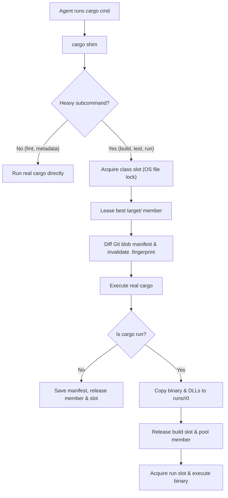
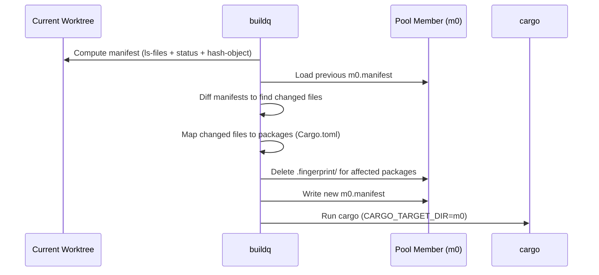

# Architecture & Internals

English | [日本語](architecture.ja.md)

This document explains the internal design of `buildq`:
the file-locked queue, the content-addressed `target/` directory pool, garbage collection, and the remote execution protocol.



## 1. Daemonless Queue

`buildq` uses plain files and OS-level file locks instead of a background daemon.
Every process (and every agent sandbox) coordinates through a shared directory (`$BUILDQ_DIR`).

### Directory Layout

```text
$BUILDQ_DIR/<class>/
  queue.lock                           # Short critical section for enqueueing and slot assignment
  seq                                  # Monotonic ticket counter (wall-clock ms as floor)
  slot-<i>.lock / slot-<i>.json        # Held by the active job in slot i
  tickets/t-<seq>-<pid>.lock / .json   # Held by each waiting job
```

### Locking & Crash Safety

- OS file locks (`LockFileEx` on Windows, `flock` on Unix via `std::fs::File::lock`)
- Tied directly to open file descriptors
  - Process crash or kill automatically releases slot and ticket locks
  - Tickets whose lock can be acquired are dead and pruned automatically
  - Slots whose lock can be acquired are free

### Scheduling & Priority

- Waiters poll every `250 ms` (configurable via `poll_ms`)
- Under `queue.lock`, a waiter lists live tickets sorted by `(priority DESC, seq ASC)`
- Waiter claims a free slot only when its rank is below the number of free slots
- Strict FIFO ordering within the same priority
- Higher-priority jobs overtake waiting jobs, without preempting running jobs

### Job Classes & Nesting

- Independent slot pools per class
  - `build`: concurrent compilations (default: `slots = 2`)
  - `run`: concurrent application runs (default: `run_slots = 2`)
  - `host-<name>`: jobs dispatched to a specific remote SSH host
  - Custom classes in `[classes]` (e.g., `gpu = 1`)
- **Deadlock prevention**
  - Active jobs export `BUILDQ_HELD=<classes held>` to child processes
  - Nested `buildq` or `cargo` shim calls seeing their class in `BUILDQ_HELD` bypass the queue
  - Build scripts calling `cargo metadata` or tests invoking `cargo build` never deadlock

### Process Tree & Signal Handling

- Ignores `Ctrl+C` in `buildq` while a child runs (the terminal delivers it to the child) and forwards the exit code
- **Windows**
  - Runs the child inside a kill-on-close Job Object (`kill_tree = true` by default)
  - Terminating `buildq` immediately terminates the entire compiler process tree
  - A freed slot never hides a lingering background build
- **Unix**
  - Forwards `SIGTERM` and `SIGHUP` directly to the child process
  - A watchdog process (`buildq __watch`) inherits the slot and pool-member locks
  - If `buildq` dies first (even by `SIGKILL`), the watchdog kills the child's process tree (`kill_tree = true`) or waits for the child to exit (`kill_tree = false`), and only then releases the locks

## 2. Shared `target/` Pool

### Directory Layout

```text
$BUILDQ_CACHE/
  pools/<repo>-<hash(repo, toolchain)>/
    pool.json                 # Repository common git dir & toolchain (rustc -vV)
    pool.lock                 # Short critical section for leasing a member
    m<i>/                     # Plain cargo target directory (CARGO_TARGET_DIR)
    m<i>.lock                 # Exclusive lock held by the job using member i
    m<i>.json                 # Metadata: last use, last worktree, byte size, job count
    m<i>.manifest             # Map of relative file path -> git blob ID
  runs/r<i>/ (+ .lock/.json)  # Isolated executables and DLLs for `cargo run`
  trash/                      # Directories staged for asynchronous deletion
```

- **Pool**: groups all worktrees of a Git repository (`git rev-parse --git-common-dir`) on one Rust toolchain (`rustc -vV`)
- **Members**: up to `max_members` target directories (`m0`, `m1`, ...) per pool
- **Exclusive lease**: each build leases one member exclusively (requires at least `slots` members for parallel builds)

### Why Naive Sharing Fails

Cargo names compiled artifacts `<crate>-<hash>`.
For workspace crates, Cargo hashes the package path **relative to the workspace root**.
`crates/core` therefore produces the exact same hash in every Git worktree.

While this enables artifact reuse across worktrees, a naively shared `CARGO_TARGET_DIR` is unsafe:
- Cargo determines freshness by comparing file modification times (`mtime`)
- Worktree A builds `crates/core` at `12:05`
- Worktree B modified `crates/core/src/lib.rs` earlier at `12:00`
- When Worktree B builds against the shared `target/`, Cargo sees the artifact (`12:05`) is newer than B's source (`12:00`) and **silently reuses A's stale code**

### The Fix: Git Blob Manifests & Fingerprint Invalidation

`buildq` tracks content hashes instead of timestamps.
Each member stores `m<i>.manifest`, mapping every source file path to the Git blob ID reflected by its artifacts.



Before starting a build on member `m<i>`:

1. **Snapshot worktree state**
   - Computes the worktree manifest via `git ls-files -s` and `git status`
   - Hashes modified and untracked files with `git hash-object` (ignoring gitignored files)
2. **Diff against member**
   - Compares the worktree manifest against `m<i>.manifest`
   - Maps each changed file to its owning Cargo package (nearest ancestor `Cargo.toml` with `[package]`)
3. **Invalidate fingerprints**
   - Deletes `.fingerprint/<pkg>-*` across all profiles and target triples inside `m<i>`
   - Forces Cargo to rebuild those packages and their dependents regardless of `mtime`
   - Preserves `rustc`'s incremental cache so the rebuild remains incremental
4. **Update manifest**
   - Writes the current worktree manifest to `m<i>.manifest`

**Safety Invariant**:
For every package in `m<i>`, either its fingerprints are absent, or its artifacts reflect the exact content in `m<i>.manifest`.
Because invalidation happens *before* Cargo runs, this holds across partial builds (`-p foo`), failed builds, and killed builds.

### Member Selection Algorithm

Under `pool.lock`, `buildq` scores every free member by the tuple:

```text
(never_built, estimated_workspace_rebuilds, differing_files, last_used_by_other_worktree, least_recent)
```

The rebuild estimate counts the union of invalidated packages and their transitive
workspace dependents, counting each package once. `cargo metadata --no-deps`
provides workspace path edges, including renamed, optional, target, build and dev
dependencies. This is a conservative estimate independent of selected features or
`-p`; registry/git dependencies do not contribute. Unknown or deleted packages
count as one. If metadata is unavailable, selection falls back to raw package
counts. The graph is loaded once per job, before taking `pool.lock`.

The lowest score wins:
1. Re-leases the exact member the worktree used last (`0` packages to invalidate)
2. Otherwise picks the member whose sources are closest to the current worktree
3. Creates a new member only when all members are busy, count is below `max_members`, and the disk budget has room

## 3. Two-Phase `cargo run`

On Windows, the OS locks running `.exe` files.
Running a binary directly inside `m0/debug/app.exe` would cause subsequent builds in `m0` to fail.

`buildq` splits `cargo run` (and aliases resolving to `run`) into two phases:

1. **Build Phase** (holds `build` slot + pool member `m<i>`)
   - Runs `cargo build` with `--message-format=json-render-diagnostics` and the resolved `--bin`
   - Parses Cargo's JSON artifact messages for the executable, DLLs/dylibs, `.pdb` symbols, and link paths
   - Incrementally copies new or modified files (by size and `mtime`) into `$BUILDQ_CACHE/runs/r<j>`
2. **Run Phase** (holds `run` slot; `build` slot and `m<i>` released)
   - Executes the copied binary from `runs/r<j>` in the caller's working directory
   - Sets `PATH` / `LD_LIBRARY_PATH`, `CARGO_MANIFEST_DIR`, and `CARGO_PKG_*` so asset paths (e.g., Bevy's `assets/`) resolve normally

## 4. Disk Budget & Garbage Collection

`buildq gc` runs automatically in the background after pooled builds (throttled to every 10 minutes unless over budget).

The effective budget adapts to available volume space:

$$\text{effective\_budget} = \min(\text{budget}, \text{used} + \text{free} - \text{min\_free})$$

GC prunes artifacts in five stages from cheapest to most aggressive, skipping busy members:

1. **Trash cleanup**: deletes leftover directories in `trash/`
2. **Stale incremental & unit artifacts** (inside idle members)
   - Incremental sessions other than the newest finalized session per crate
   - Incremental crate directories untouched for `incremental_days` (default: `3`)
   - Superseded artifact variants (same crate, older hash) untouched for `stale_unit_days` (default: `14`)
3. **Idle pools**: removes entire pools unused for `pool_idle_days` (default: `21`)
4. **Idle run directories**: removes `runs/r<i>` directories unused for 2 days
5. **LRU member eviction**: evicts complete idle pool members in least-recently-used order until under budget

### Explicit Target Dirs

A job that sets `--target-dir` or `CARGO_TARGET_DIR` itself (e.g. an agent building an A/B baseline) bypasses the pool by default:

- buildq prints a one-line notice (`explicit target dir ...: not pooled, outside the disk budget`)
- The dir is recorded in `<cache>/external.json` and in the job's history entry
- `buildq cache ls` and `buildq gc` report its size and warn when pool + explicit dirs exceed the budget
  - GC never deletes these dirs: the job chose the path
- With `[cache] pool_explicit = true`, an explicit dir **inside the worktree** is pooled instead
  - Re-rooted into the member as `m<i>/sub/<relative path>` and counted in the budget
  - Fresh top-level binaries are copied back to the requested dir

## 5. Remote Execution Protocol (SSH)

`buildq run --host <host>` offloads builds over standard SSH and Git.
The remote host only needs `git`, a POSIX shell, and the Rust toolchain.

1. **Local slot**
   - Acquires a local `host-<name>` slot to cap concurrency sent to that host
2. **Git snapshot**
   - Creates a **parentless commit** of all tracked and untracked files via a temporary Git index
   - Leaves local `HEAD`, index, and working tree untouched
3. **Incremental push**
   - Initializes a bare repository on the host (`<root>/<repo>-<hash>/repo.git`)
   - Pushes the snapshot to `refs/buildq/<worktree-id>`, transferring only changed blobs
4. **Remote checkout**
   - Checks out the commit into a remote `git worktree` (`wt/<worktree-id>`)
   - Rewrites only modified files, preserving `mtime` and Cargo's remote incremental cache
5. **Execution**
   - Runs the command in the matching subdirectory over SSH
   - Wraps the command in `buildq run` if `buildq` is configured on the host
6. **Artifact fetch**
   - Copies `--fetch <path>` artifacts back via `scp` into `target/buildq-remote/<host>/`

## 6. Design Alternatives Considered

| Approach | Why rejected or superseded |
| :--- | :--- |
| **Per-worktree `target/`<br>(Status Quo)** | Duplicates 5–20 GB per worktree;<br>forces a cold build for every new worktree |
| **Naive shared<br>`CARGO_TARGET_DIR`** | Serializes all builds on one Cargo lock;<br>silently links stale code when `mtime` differs |
| **Mirror checkout<br>(`rsync` to fixed path)** | Breaks `CARGO_MANIFEST_DIR`, relative test fixtures,<br>snapshot tests, and asset directories |
| **`--remap-path-prefix`** | Only rewrites paths inside debug info / panics;<br>Cargo already hashes workspace paths relatively |
| **`sccache`** | Cannot share incremental (`dev`) workspace crates;<br>sandbox-started server often cannot write other sandboxes |

## 7. Known Limitations

- **Gitignored files**
  - Freshness for generated sources under gitignored paths relies on Cargo's `mtime` rule
- **Embedded absolute paths**
  - Debug info (`file!()`, DWARF/PDB paths) in reused dependencies points to the worktree that compiled them
- **Direct binary paths**
  - Invoking `./target/debug/app` directly requires `[cargo] mirror_bins = true` in `config.toml`
- **Background processes on Windows**
  - With `kill_tree = true` (default), background processes spawned during a build are terminated when the job exits
- **Remote host shell**
  - Remote hosts require a POSIX default shell (Windows SSH hosts must use Git Bash as the default OpenSSH shell)
