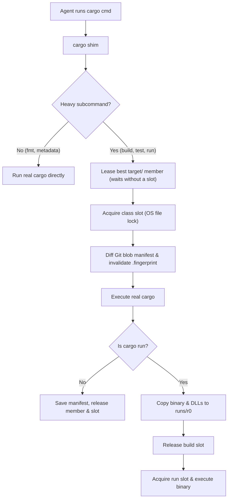
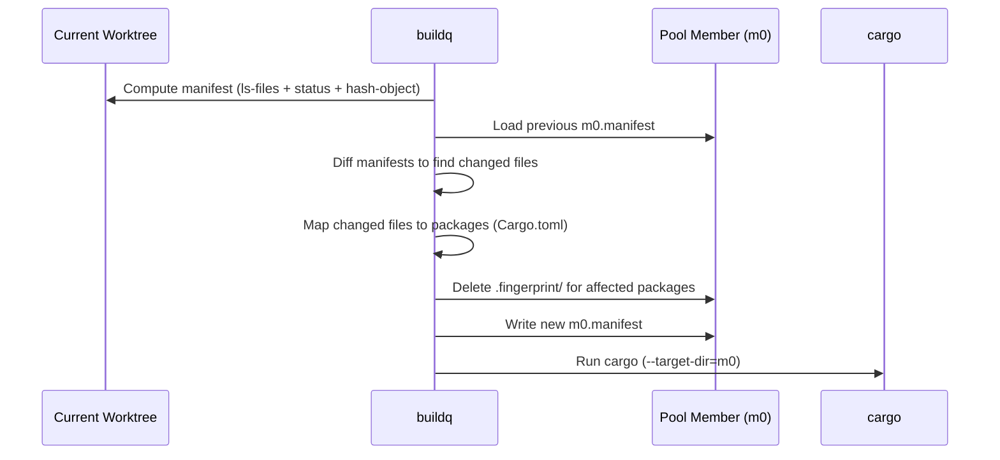

# Architecture & Internals

English | [日本語](architecture.ja.md)

This document explains the internal design of `buildq`:
the file-locked queue, the content-addressed `target/` directory pool, garbage collection, and the remote execution protocol.



## 1. Daemonless Queue

`buildq` uses plain files and OS-level file locks instead of a background daemon.
Every process (and every agent sandbox) coordinates through a shared directory (`$BUILDQ_DIR`).

### Directory Layout

```text
$BUILDQ_DIR/<class>/
  queue.lock                           # Short critical section for enqueueing and slot assignment
  seq                                  # Monotonic ticket counter (wall-clock ms as floor)
  slot-<i>.lock / slot-<i>.json        # Held by the active job in slot i
  tickets/t-<seq>-<pid>.lock / .json   # Held by each waiting job
```

### Locking & Crash Safety

- OS file locks (`LockFileEx` on Windows, `flock` on Unix via `std::fs::File::lock`)
- Tied directly to open file descriptors
  - Process crash or kill automatically releases slot and ticket locks
  - Tickets whose lock can be acquired are dead and pruned automatically
  - Slots whose lock can be acquired are free

### Scheduling & Priority

- Waiters poll every `250 ms` (configurable via `poll_ms`)
- Under `queue.lock`, a waiter lists live tickets grouped by the worktree cap, then sorted by `(priority DESC, seq ASC)`
- Waiter claims a free slot only when its rank is below the number of free slots
- Strict FIFO ordering within the same group and priority
- Higher-priority jobs overtake waiting jobs, without preempting running jobs

The cap applies separately within each job class, using the Git worktree root
(or the current directory outside Git) as identity.
When another worktree is queued below its cap, its tickets precede tickets
from worktrees already at their cap.
Within each group, higher priority runs first, then strict FIFO.
When all waiting worktrees are at their cap, jobs can still use idle slots.
`buildq status` marks deferred tickets with `waiting: worktree cap`.
Nested calls using `BUILDQ_HELD` remain exempt.

### Job Classes & Nesting

- Independent slot pools per class
  - `build`: concurrent compilations (default: `slots = 2`)
  - `run`: concurrent application runs (default: `run_slots = 2`)
  - `host-<name>`: jobs dispatched to a specific remote SSH host
  - Custom classes in `[classes]` (e.g., `gpu = 1`)
- **Deadlock prevention**
  - Active jobs export `BUILDQ_HELD=<classes held>` to child processes
  - Nested `buildq` or `cargo` shim calls seeing their class in `BUILDQ_HELD` bypass the queue
  - Nested calls avoid re-entering a queue slot held by their ancestor

### Nested Cargo

Built-in compilation commands and clippy receive the pool target through
`--target-dir`. buildq does not introduce an inherited `CARGO_TARGET_DIR` that
would force a helper onto its parent's locked target. Separate helper workspaces
use their normal targets, including further nested helpers. Explicit caller
environment overrides retain their usual behavior.

Existing default targets beside other Cargo.toml files in the source manifest
are recorded as external storage. They remain outside the pool budget and GC
never deletes them; arbitrary custom target paths from Cargo configuration are
not inferred by this discovery. A helper can instead pass `--target-dir` under
its parent's `OUT_DIR` to keep storage and lifetime inside the leased member.

Custom Cargo plugins retain environment-based target scoping to preserve their
CLI contracts. Helpers in those plugins must explicitly select an independent
target. Recursively building the same workspace still has Cargo's own locking
constraints; `BUILDQ_HELD` prevents queue reentry only.

### Process Tree & Signal Handling

- Ignores `Ctrl+C` in `buildq` while a child runs (the terminal delivers it to the child) and forwards the exit code
- **Windows**
  - Runs the child inside a kill-on-close Job Object (`kill_tree = true` by default)
  - Terminating `buildq` immediately terminates the entire compiler process tree
  - A freed slot never hides a lingering background build
- **Unix**
  - Forwards `SIGTERM` and `SIGHUP` directly to the child process
  - A watchdog process (`buildq __watch`) inherits the slot and pool-member locks
  - If `buildq` dies first (even by `SIGKILL`), the watchdog kills the child's process tree (`kill_tree = true`) or waits for the child to exit (`kill_tree = false`), and only then releases the locks

## 2. Shared `target/` Pool

### Directory Layout

```text
$BUILDQ_CACHE/
  pools/<repo>-<hash(repo, toolchain)>/
    pool.json                 # Repository common git dir & toolchain (rustc -vV)
    pool.lock                 # Short critical section for leasing a member
    m<i>/                     # Plain cargo target directory (--target-dir)
    m<i>.lock                 # Exclusive lock held by the job using member i
    m<i>.json                 # Metadata: last use, last worktree, byte size, job count
    m<i>.manifest             # Map of relative file path -> git blob ID
  runs/r<i>/ (+ .lock/.json)  # Isolated executables and DLLs for `cargo run`
  trash/                      # Directories staged for asynchronous deletion
```

- **Pool**: groups all worktrees of a Git repository (`git rev-parse --git-common-dir`) on one Rust toolchain (`rustc -vV`)
- **Members**: up to `max_members` target directories (`m0`, `m1`, ...) per pool
- **Exclusive lease**: each build leases one member exclusively (requires at least `slots` members for parallel builds)
- **Lease before slot**: a build takes its member first and a build slot second, so a job waiting for a busy member (e.g. one retained by a native app) holds no machine-wide capacity and independent repositories keep building. Slot holders never wait for a member, so the order cannot deadlock

### Why Naive Sharing Fails

Cargo names compiled artifacts `<crate>-<hash>`.
For workspace crates, Cargo hashes the package path **relative to the workspace root**.
`crates/core` therefore produces the exact same hash in every Git worktree.

While this enables artifact reuse across worktrees, a naively shared `CARGO_TARGET_DIR` is unsafe:
- Cargo determines freshness by comparing file modification times (`mtime`)
- Worktree A builds `crates/core` at `12:05`
- Worktree B modified `crates/core/src/lib.rs` earlier at `12:00`
- When Worktree B builds against the shared `target/`, Cargo sees the artifact (`12:05`) is newer than B's source (`12:00`) and **silently reuses A's stale code**

### The Fix: Git Blob Manifests & Fingerprint Invalidation

`buildq` tracks content hashes instead of timestamps.
Each member stores `m<i>.manifest`, mapping every source file path to the Git blob ID reflected by its artifacts.



Before starting a build on member `m<i>`:

1. **Snapshot worktree state**
   - Computes the worktree manifest via `git ls-files -s` and `git status`
   - Hashes modified and untracked files with `git hash-object` (ignoring gitignored files)
   - Replaces each initialized submodule's gitlink with the submodule's own manifest, recursively, so path dependencies inside submodules are compared by content
   - Path dependencies outside the worktree (or in Git-ignored directories) are not in the manifest: their freshness relies on Cargo's mtime checks only, and each job lists them in a note
2. **Diff against member**
   - Compares the worktree manifest against `m<i>.manifest`
   - Maps each changed file to its owning Cargo package (nearest ancestor `Cargo.toml` with `[package]`)
3. **Invalidate fingerprints**
   - Deletes `.fingerprint/<pkg>-*` across all profiles and target triples inside `m<i>`
   - Forces Cargo to rebuild those packages and their dependents regardless of `mtime`
   - Preserves `rustc`'s incremental cache so the rebuild remains incremental
4. **Update manifest**
   - Writes the current worktree manifest to `m<i>.manifest`

**Safety Invariant**:
For every package in `m<i>`, either its fingerprints are absent, or its artifacts reflect the exact content in `m<i>.manifest`.
Because invalidation happens *before* Cargo runs, this holds across partial builds (`-p foo`), failed builds, and killed builds.

A source-root change invalidates every local package so embedded paths such as
`CARGO_MANIFEST_DIR` refer to the current worktree. Registry/git dependencies
stay shared; same-root builds retain normal incremental reuse.

### Member Selection Algorithm

Under `pool.lock`, `buildq` scores every free member by the tuple:

```text
(never_built, packages_to_rebuild, differing_files, last_used_by_other_worktree, least_recent)
```

The rebuild cost counts the union of invalidated packages and their transitive
workspace dependents from `cargo metadata --no-deps --offline`. Shared dependents
count once. Optional, build, dev, and target-specific dependencies are included
conservatively; this estimates package rebuilds, rather than compile time.
If metadata is unavailable, scoring falls back to the invalidated package count.
Source-root changes still invalidate every local package before scoring.

The lowest score wins:
1. Prefers an already-built member with the fewest packages to rebuild
2. Breaks ties by differing files, worktree affinity, and recency
3. Creates a new member only when all members are busy, count is below `max_members`, and the disk budget has room

## 3. Two-Phase `cargo run`

Before compiling, Cargo metadata selects exactly one runnable package and
target, respecting the invocation's default members, manifest, package, bin,
example, and default-run settings. Ambiguous selections exit with code `101`
before acquiring a build slot or launching an application. Artifact messages
are accepted only for that package, target name, and target kind.

On Windows, the OS locks running `.exe` files.
Running a binary directly inside `m0/debug/app.exe` would cause subsequent builds in `m0` to fail.

`buildq` splits `cargo run` (and aliases resolving to `run`) into two phases:

1. **Build Phase** (holds pool member `m<i>`, then `build` slot)
   - Runs `cargo build` with `--message-format=json-render-diagnostics` and the resolved `--bin`
   - Parses Cargo's JSON artifact messages for the executable, DLLs/dylibs, `.pdb` symbols, and link paths
   - Incrementally copies new or modified files (by size and `mtime`) into `$BUILDQ_CACHE/runs/r<j>`
2. **Run Phase** (holds `run` slot; `build` slot released)
   - Executes the copied binary from `runs/r<j>` in the caller's working directory
   - Sets `PATH` / `LD_LIBRARY_PATH`, `CARGO_MANIFEST_DIR`, and `CARGO_PKG_*` so asset paths (e.g., Bevy's `assets/`) resolve normally

When native shared libraries remain in the member, its exclusive lease stays
held from run-slot waiting through application exit. Build outputs, link-search
directories, and profile/deps libraries are inspected, excluding copied Rust
libraries. Keeping the dependency member busy protects absolute loader paths
and late loading from GC. The build slot is released, but available pool
capacity is reduced. These bytes remain accounted as busy artifacts; application
exit releases the lease and triggers another GC attempt.

The application receives Cargo `[env]` from home/ancestor configs and `--config`,
including `force` and config-relative paths ([Cargo rules](https://doc.rust-lang.org/cargo/reference/config.html#env)).

The run phase honors Cargo target runners for the selected build target.
Exact target-triple entries take precedence over matching `cfg(...)` entries;
multiple matching cfg runners are rejected. Runner strings, argument arrays,
config-relative executable paths, environment overrides, and `--config` are
resolved before building. The runner receives the staged executable followed by
the application arguments and executes under the run slot.

## 4. Disk Budget & Garbage Collection

Automatic GC runs after pooled builds, in the background by default or in the
current process with `[cache] gc_mode = "inline"`. A parent-side preflight avoids
creating a collector for recent, under-budget usage; the collector rechecks under
the GC lock. Both modes throttle to 10 minutes unless over budget. Background
mode requires a reaping init on Unix; inline mode trades return latency for a
bounded collector lifecycle. Neither mode adds a persistent daemon. See
[Automatic GC](usage.md#automatic-gc).

The cache budget is a soft retention limit. Busy members and run copies are
protected, so active builds may temporarily exceed it. `cache ls --json` and
`gc --json` expose `over_budget`, `over_budget_bytes`, and
`over_budget_reasons`; text output and `top` also show warnings. GC reports
remaining overflow without treating protected busy artifacts as a deletion
failure. Its exit status remains successful unless a deletion fails.

An oversized build may finish if the free-space guard permits it. A completed
member larger than the entire configured budget produces a warning with guidance
to increase the budget or reduce artifacts. GC can evict that member once idle,
even if it is the only one; the next invocation then starts cold. Member-size
diagnostics reuse estimates for up to 60 seconds, with an initial measurement
after the first build and fresh measurements during actual GC. This avoids
walking a warm target directory after every job.

The effective budget adapts to available volume space:

```math
\text{effective\_budget} = \min(\text{budget}, \text{used} + \text{free} - \text{min\_free})
```

### Size Accounting

`[cache] accounting = "allocated"` is the default. Unix uses allocated file
blocks (`st_blocks * 512`); Windows uses file allocation size. Both deduplicate
hardlinks by volume/device and file identity within each member, run directory,
or trash entry. Symlinks and directory metadata are excluded. Sparse holes do
not consume this budget until blocks are allocated.

`accounting = "logical"` instead counts each unique file's logical length,
including sparse holes. Cache estimates record their basis and refresh when it
changes. JSON reports expose `accounting`; text output labels the selected basis.

Accounting units remain independent for cached estimates and eviction. Hardlinks
across units, and reflink/shared extents across different file identities, are
conservatively charged to each unit. The exception is sharing that
[deduplication](#cross-member-deduplication) recorded, which is charged once. `freed` reports removed accounted capacity,
not an exact change in volume free space. Action sizes describe path footprints
and are not additive: pruning remeasures the member so deleting one alias cannot
claim a retained inode's bytes. Dry runs project the same exclusions. Failed-trash
estimates are kept separately for each accounting mode, with legacy estimates
retained when permissions prevent remeasurement.

### Collection Stages

GC prunes artifacts in five stages from cheapest to most aggressive, skipping busy members:

1. **Trash cleanup**: deletes leftover directories in `trash/`
2. **Stale incremental & unit artifacts** (inside idle members)
   - Incremental sessions other than the newest finalized session per crate
   - Incremental crate directories untouched for `incremental_days` (default: `3`)
   - Superseded artifact variants (same crate, older hash) untouched for `stale_unit_days` (default: `14`)
   - Then shares identical files across idle members ([deduplication](#cross-member-deduplication))
3. **Idle pools**: removes entire pools unused for `pool_idle_days` (default: `21`)
4. **Idle run directories**: removes `runs/r<i>` directories unused for 2 days
5. **LRU member eviction**: evicts complete idle pool members in least-recently-used order until under budget

Failed deletions report their remaining path and error, and `buildq gc` exits
nonzero. Only reclaimed bytes count as freed. Pending trash is included in
`cache ls` totals and budget calculations; GC retries it on subsequent runs.
If permissions prevent measuring failed trash, the last known remaining size
is retained as an estimate. GC does not change permissions automatically: repair
the reported path's permissions or file locks and rerun GC.

Automatic budget checks may defer enforcement until the next refresh.
`cache ls --refresh` and actual GC passes remeasure before eviction.

### Cross-Member Deduplication

Members on one toolchain often hold byte-identical registry dependency artifacts
under the same relative path, even across repositories. After stage 2, GC shares
them as reflinks:

1. **Index idle members** without holding their locks
   - Files of at least `dedupe_min_size` (default: `64KiB`)
   - Excludes `incremental/` and `.fingerprint/`
   - Groups by toolchain, volume, relative path, and length
2. **Share each copy** with its group's first copy under both member locks
   - Rechecks the indexed inode, length, and mtime
   - A copy that differs from the first is compared with the next differing copy, so a group with several contents shares within each
   - Releases the locks every 1 GiB or second so leases are not starved
   - Linux: `FIDEDUPERANGE`; the kernel compares bytes and keeps the inode
   - macOS: compares bytes, `clonefile`s, restores mode and timestamps, then `rename`s over the path
3. **Record shared paths** in `$BUILDQ_CACHE/dedupe.json`

**Invariant**:
A pass never changes a path's content, length, mode, or mtime.
Fingerprints, member manifests, and the pool safety invariant therefore stay valid.

Allocated block counts report every clone in full. Usage therefore subtracts
each recorded group's copies beyond the first (each at most its length rounded
up to whole blocks: preallocation beyond EOF is not shared) while every recorded device,
inode, length, mtime, and ctime still matches. A rewrite drops that path from
its group, even one that restores the old mtime; so does any other status
change, such as adding or removing a hard link, which only overstates usage.
An inode recorded twice counts once. Eviction claims only bytes
that no remaining member shares.

Manual `buildq gc` and background collectors run a pass, automatic ones at most
hourly. Inline GC never does, because a job waits for it. A pass reads at most
`dedupe_max_read` (default: `8G`); the next pass starts at the member pair
where the limit stopped it. Copies found different are recorded too and
skipped until either file changes. Volumes without reflinks report the pass as
unsupported and change nothing.

### Free-Space Guard

Before leasing a pooled member, a Cargo build checks free space on the cache
volume. At or below `min_free`, it runs GC once and refuses the build with exit
code `125` if space is still insufficient. It does not hold a slot waiting for
space to become available.

During pooled compilation, free space is checked every 100 ms and at completion.
A failed check stops the build process tree before releasing its slot and member;
`cargo run` does not launch the application. This also applies with
`kill_tree = false`. History records the failed build, and a later invocation
can retry after space is recovered. Failure to measure free space also refuses
the build.

This is a best-effort reserve, not a filesystem quota: concurrent writers can
consume space between checks. Set `[cache] min_free = "0"` to disable the guard.
Commands outside the target pool are not guarded.

Idle-pool retirement holds `pool.lock`, rechecks member activity, and acquires
all current member locks before deleting artifacts. Coordination directories and
lock files remain in place, including after complete eviction. This preserves
lock identity for waiters that opened a file before GC; empty retired pools are
omitted from cache listings.

### Explicit Target Dirs

A job that sets `--target-dir` or `CARGO_TARGET_DIR` itself (e.g. an agent building an A/B baseline) bypasses the pool by default:

- buildq prints a one-line notice (`explicit target dir ...: not pooled, outside the disk budget`)
- The dir is recorded in `<cache>/external.json` and in the job's history entry
- `buildq cache ls` and `buildq gc` report its size and warn when pool + explicit dirs exceed the budget
  - GC never deletes these dirs: the job chose the path
- With `[cache] pool_explicit = true`, an explicit dir **inside the worktree** is pooled instead
  - Re-rooted into the member as `m<i>/sub/<relative path>` and counted in the budget
  - Fresh top-level binaries are copied back to the requested dir

## 5. Remote Execution Protocol (SSH)

`buildq run --host <host>` offloads builds over standard SSH and Git.
The remote host only needs `git`, a POSIX shell, and the Rust toolchain.

1. **Local slot**
   - Acquires a local `host-<name>` slot to cap concurrency sent to that host
2. **Git snapshot**
   - Creates a **parentless commit** of all tracked and untracked files via a temporary Git index
   - Leaves local `HEAD`, index, and working tree untouched
3. **Incremental push**
   - Initializes a bare repository on the host (`<root>/<repo>-<hash>/repo.git`)
   - Pushes the snapshot to `refs/buildq/<worktree-id>`, transferring only changed blobs
4. **Remote checkout**
   - Checks out the commit into a remote `git worktree` (`wt/<worktree-id>`)
   - Rewrites only modified files, preserving `mtime` and Cargo's remote incremental cache
5. **Execution**
   - Runs the command in the matching subdirectory over SSH
   - Wraps the command in `buildq run` if `buildq` is configured on the host
6. **Artifact fetch**
   - Copies `--fetch <path>` artifacts back via `scp` into `target/buildq-remote/<host>/`

### Host Selection & Transports

Automatic selection probes each candidate before choosing it. With `buildq` set,
it reads the host's build slots and queue via `status --json`; otherwise it uses
Linux `/proc/loadavg` and the CPU count. Local dispatch limits still apply.
Failed probes and Rust version mismatches exclude that host. `local` is used as a
fallback only when listed among the candidates. Each probe has a five-second
deadline and does not prompt for SSH passwords. Set `rustc_release` to require the
remote default `rustc --version` release (including for explicitly selected hosts);
`hosts.<name>.env` also applies to probes. This checks the configured default
compiler, not every Cargo `+toolchain` override or installed compilation target.

Set `transport = "rsync"` for a POSIX client (Linux, macOS, or WSL) with `rsync`
installed on both ends. This mirrors all files, including gitignored generated
inputs, except the root `.git` entry and `target/`. Deleted source files are
removed remotely; remote `target/` artifacts survive subsequent syncs. Checksums
catch source changes even when size and timestamps match. Remote Git snapshots
are recorded on the host, including generated inputs, so remote buildq pooling
retains content invalidation. `--fetch` also uses rsync. The default `git`
transport remains available on Windows and requires no rsync installation.

## 6. Design Alternatives Considered

| Approach | Why rejected or superseded |
| :--- | :--- |
| **Per-worktree `target/`<br>(Status Quo)** | Duplicates 5–20 GB per worktree;<br>forces a cold build for every new worktree |
| **Naive shared<br>`CARGO_TARGET_DIR`** | Serializes all builds on one Cargo lock;<br>silently links stale code when `mtime` differs |
| **Mirror checkout<br>(`rsync` to fixed path)** | Breaks `CARGO_MANIFEST_DIR`, relative test fixtures,<br>snapshot tests, and asset directories |
| **`--remap-path-prefix`** | Only rewrites paths inside debug info / panics;<br>Cargo already hashes workspace paths relatively |
| **`sccache`** | Cannot share incremental (`dev`) workspace crates;<br>sandbox-started server often cannot write other sandboxes |

## 7. Known Limitations

- **Gitignored files**
  - Freshness for generated sources under gitignored paths relies on Cargo's `mtime` rule
- **Embedded absolute paths**
  - Debug info (`file!()`, DWARF/PDB paths) in reused dependencies points to the worktree that compiled them
- **Direct binary paths**
  - Invoking `./target/debug/app` directly requires `[cargo] mirror_bins = true` in `config.toml`
- **Background processes on Windows**
  - With `kill_tree = true` (default), background processes spawned during a build are terminated when the job exits
- **Reflink support**
  - Deduplication runs on Linux (btrfs, XFS with `reflink=1`, bcachefs) and macOS (APFS) only
  - On macOS, hard-linked copies such as uplifted binaries have every name re-linked to the clone; a copy with a name the pass does not index (for example under `incremental/`) is skipped, since replacing it would split the names
- **Remote host shell**
  - Remote hosts require a POSIX default shell (Windows SSH hosts must use Git Bash as the default OpenSSH shell)
