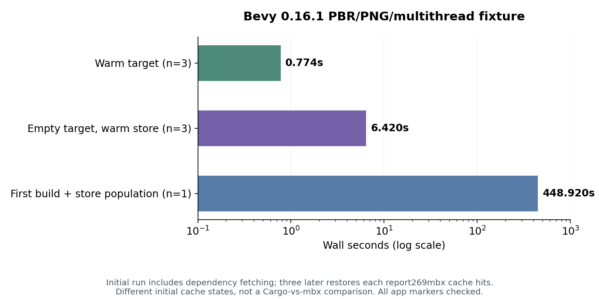
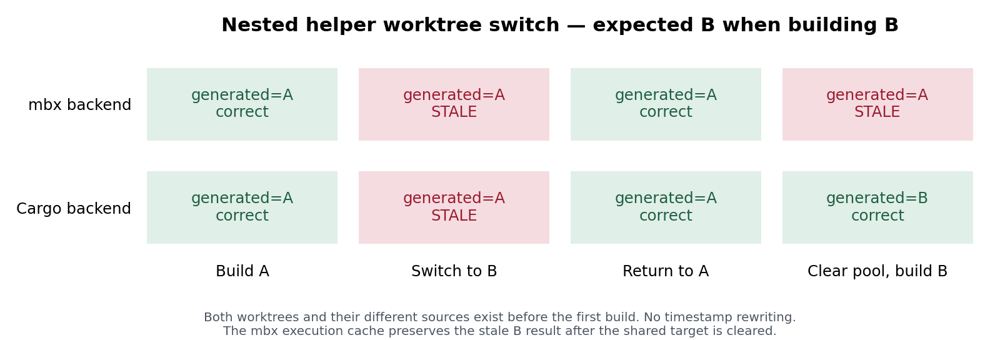

# mbx integration QA and reproducible evidence

Tested buildq `1391d00` with real mr-boxington **1.27.0**, Rust/Cargo **1.89.0**, Linux overlay, a shared **4-CPU quota / 16 GiB RAM** host. No upstream OSS repository received an issue, pull request, or push. All upstream sources were downloaded and exercised locally. [provenance.json](provenance.json) records archive URLs, SHA-256 hashes, exact versions, and fixture lockfile hashes. The mbx release archive matches its published [SHA256SUMS](mbx-release-SHA256SUMS).

## Results that matter

The real compiler cache provides substantial reuse after a pooled target is discarded. It also preserves an incorrect generated result if an earlier buildq run supplied a stale nested helper. That correctness issue should be fixed before treating nested builds as safe across differing worktrees.

| Scenario | Result | Evidence |
| --- | --- | --- |
| ripgrep 14.1.1, identical source, target removed before each build | Three Cargo rebuilds: median **32.900 s**. Three builds with a prewarmed mbx store: median **1.168 s**, **44/45/45 hits** | [paired-summary.json](paired-summary.json), `paired-*-rebuild.*` |
| Bevy 0.16.1 PBR/PNG/multithread application fixture | First build/store population **448.920 s**; three discarded-target restores **6.170 / 6.917 / 6.420 s**, each **269 hits** | [exact fixture + lockfile](bevy-fixture/Cargo.toml), `bevy-mbx-cold.*`, `bevy-restore-*` |
| Bevy application correctness | Original A, changed C, switch back A, then six concurrent A/C runs all print the correct worktree marker and `entities=1` | `bevy-changed-C.stdout`, `bevy-back-A.stdout`, `bevy-burst-*.stdout` |
| rust-analyzer 2025-06-02, `cargo check -p rust-analyzer --locked` | First check **162.689 s**; second worktree **17.388 s**, **34 hits**, both succeed | `rust-analyzer-*-check.*` |
| Tokio 1.45.1, full/minimal/full features | All corrected locked checks succeed; all **135** full-feature library tests succeed | `tokio-*-fixed.*`, `tokio-full-reuse.*`, `tokio-lib-tests.*` |
| ripgrep PCRE2 feature changes | Eight concurrent system-PCRE2 jobs and eight forced bundled-C jobs all succeed, at most two build holders in sampled status | `native-*`, `static-native-*`, [burst summary](native-burst-summary.json) |
| Nested code generator, naturally older B checkout | Both backends return A when building B; mbx can replay A even after the pool is cleared | [#142](https://github.com/r4ai/buildq/issues/142), [portable results](nested-portable/results.json) |
| Eight submitted jobs, member cap two | Two holders and six live member waiters; status exposes zero queue waiters | [#150](https://github.com/r4ai/buildq/issues/150), [exact snapshot](member-wait-proof/snapshot.json) |
| Actual mbx hardlinks across members | 66 cross-member shared inode groups in the PCRE2 pool; existing hardlinks are presented as additional dry-run savings | [#147](https://github.com/r4ai/buildq/issues/147), [inode examples](native-cross-member-hardlinks.json), [real dry-run](real-mbx-dedupe-dry-run.stdout) |

The Bevy workload is a dependency-heavy application using Bevy's PBR stack; it is **not** a build of every package in the Bevy repository. rust-analyzer was checked, not linked into its full server binary by this subtask.




The ripgrep comparison clears buildq targets before every measured rebuild, uses the same pinned dependency lockfile and `--locked --offline`, and alternates backend order. Its initial dependency fetching and mbx store population are excluded. Warm-target times are recorded separately and are about 0.2–0.3 s in those pairs. The Bevy cold run includes dependency fetching, so its three cache states are scenario costs, not a Cargo-versus-mbx comparison.

Process-tree RSS and CPU are sampled every 100 ms with psutil. Short-lived subprocesses can be missed; sampled CPU is not an exact `wait4` CPU total. Other QA agents share the host throughout. These are measurements of this host and workload, not isolated hardware claims or end-to-end storage savings. Overlay has no supported reflink/FIDEDUPERANGE path here, so successful reflink seeding/deduplication is not established by these runs. mbx restores use hardlinks on this volume.

## Nested helper correctness (#142)

The parent package's build script invokes plain `cargo run` through the buildq shim to generate a string using an excluded helper workspace. It gives that helper `CARGO_TARGET_DIR=$OUT_DIR/helper-target`, a normal way to avoid the parent's Cargo target lock. Two worktrees contain different helper sources **before either is compiled**. No source timestamp is rewritten in the standalone reproduction.

1. A's helper prints A; build A successfully generates A.
2. Switch to B. buildq identifies `nested-codegen` as changed but does not invalidate the fingerprints nested below `$OUT_DIR/helper-target`.
3. Cargo reuses the older helper binary, so B exits successfully and generates **A**, although its helper source prints B.
4. The mbx build-script execution entry can now preserve that bad B result. Clearing the buildq pool alone still produces A with the mbx backend. Disabling `MBX_BUILD_SCRIPT_EXECUTION=0` before a clean rebuild produces B; `MBX_SHARE_OUT_DIR=0` alone does not.



The plain-Cargo backend becomes correct after clearing its pool. Direct `mbx build` using independent targets for A and B also produces the correct A/B outputs, recorded in [direct-mbx-build-results.json](direct-mbx-build-results.json). This supports stale nested target reuse inside buildq as the initiating error; it does not establish an independent upstream mbx compiler-cache defect.

Reproduce on another machine with a fresh destination:

```sh
python3 nested-switch.py \
  --root /tmp/new-buildq-nested-qa \
  --buildq /absolute/path/to/buildq \
  --mbx /absolute/path/to/mbx
```

Use a working Rust toolchain on PATH, or pass `--cargo /absolute/path/to/cargo`. The script creates its own fixture, local Git commits/worktrees, per-backend queue/cache/mbx roots, logs, and `results.json`. It writes only below the new root and returns **1** if it observes stale output. [nested-no-script-cache/results.json](nested-no-script-cache/results.json) and [nested-no-out-share/results.json](nested-no-out-share/results.json) record the setting ablations.

Relevant code is the held-job early return in `src/job.rs` (`run_cargo`), plus `src/pool.rs` package ownership and fingerprint discovery. The latter walks profile/target-triple locations and re-rooted `sub` targets, not arbitrary helper targets deep inside an OUT_DIR.

## Member-wait visibility (#150)

[member-wait-proof/snapshot.json](member-wait-proof/snapshot.json) preserves all eight submitted argv/PIDs, their live state, stderr snapshots, and the complete `status --json` result. Six stderr streams explicitly say all cache members are busy, while status has two busy build holders and no waiters. All eight commands eventually exit zero. This is an observability request, not evidence that the two-slot limit is exceeded.

```sh
python3 member-wait-visibility.py \
  --root /tmp/new-buildq-member-wait-qa \
  --buildq /absolute/path/to/buildq
```

The reproduction uses a dependency-free Cargo fixture with a ten-second build script. The real ripgrep burst additionally shows member-lease waits of roughly 18–48 seconds in `native-burst-*.stderr`; all 301 sampled status records still contain zero queue waiters. Jobs acquire members before entering the slot queue.

## Native C, features and real artifact sharing

`native.py` exercises the host PCRE2 dependency. `static-native.py` explicitly sets **`PCRE2_SYS_STATIC=1`** and exercises actual bundled C compilation. The latter produces `debug/build/pcre2-sys-*/out/libpcre2.a` in both members, then alternates default, no-default and PCRE2 feature sets across eight simultaneous jobs after clearing targets. Both variants print `PCRE2 10.43 is available (JIT is available)` when queried. Commands, labels, per-job memory, timings and hit counts are in [measurements.jsonl](measurements.jsonl); exact environment overrides are in the corresponding scripts. The input is the pinned ripgrep archive and original upstream Cargo.lock, whose archive hash is recorded in provenance.

Actual mbx artifacts are hardlinked across members. For example, `m0` and `m1` share serde metadata and regex-syntax libraries, not just the mbx build-script shim. [native-cross-member-hardlinks.json](native-cross-member-hardlinks.json) records device/inode identities and paths. A dry-run dedupe scan of an earlier idle mbx pool reports 147,664,896 identical bytes and zero already-shared bytes despite known cross-member hardlinks. This evidence supplements #147; it does not prove how supported btrfs/XFS/APFS volumes classify these files.

## Bounded five-project rotation

`rotation.py` runs Bevy A, an edited Bevy C/D worktree, ripgrep, Tokio and rust-analyzer together with two build slots. It repeatedly changes the source marker, runs foreground GC, and alternates a normal 4 GiB budget with a 768 MiB pressure budget. The edited Bevy output is explicitly checked against that iteration's marker. The run completed **28 iterations / 140 project jobs in 722.595 s**; all jobs exit zero and all **56** Bevy marker checks match. Its complete correctness checks are in [rotation-correctness.json](rotation-correctness.json); `rotation-*-cache.stdout`, `rotation-*-gc.stdout` and `rotation-*-status.stdout` retain every idle boundary.

This is a short bounded rotation, not a multi-day endurance result. A 768 MiB budget is intentionally too small for the completed Bevy member and, once populated, for the mbx store alone. Already tracked budget/accounting issues remain relevant: [#138](https://github.com/r4ai/buildq/issues/138), [#139](https://github.com/r4ai/buildq/issues/139), and [#151](https://github.com/r4ai/buildq/issues/151). For example, `rotation-2-gc.stdout` reports `over_budget=false`, while the immediately following fresh `rotation-2-cache.stdout` reports a 1,736,468,702-byte mbx budget reserve against the configured 805,306,368-byte budget and `over_budget=true`. Cached store/shared-inode measurements can differ from the forced fresh listing after members are evicted. [Captured transition snapshots](rotation-discount-transitions.jsonl) retain each cached `mbx-usage.json`, current pool membership and direct mbx statistics. In one [derived bookend pair](rotation-discount-membership-pairs.json), members drop from one to zero while the direct store remains exactly 1,738,457,058 bytes and the cached shared discount remains 1,322,868,736 bytes. This stale discount is distinct from the zero-effective-budget reporting formula.

## Cancellation and cache integrity

After rotation, a real Bevy `--release` compilation was interrupted by sending **SIGTERM to the buildq parent only**. buildq returned **143** after **0.166 s**. The next debug build/run prints the correct A marker, and mbx verifies **3,686 objects and 630 action results** without corruption. [cancellation-summary.json](cancellation-summary.json) records the exact argv, observed descendant identities and termination timing.

There are no remaining live descendants, but **five descendant zombies** (Cargo, mbx-rustc and rustc) remain adopted by PID 1. The later [identity-checked recheck](cancellation-descendants-recheck.json) confirms their `zombie` status and `ppid=1`. Therefore this is **not an unqualified orphan-free or fully reaped pass**. The script's `passed` field checks nonzero cancellation exit plus absence of live descendants; it does not assert zero zombies. Container process supervision is a real limit for cancellation-heavy use, in addition to the existing background-GC supervision guidance. The store-integrity and recovery checks pass independently.

## Reading the raw evidence

- [measurements.jsonl](measurements.jsonl): commands, cwd, exit code, wall time, sampled process-tree RSS/CPU, compiler-line counts and mbx hit summaries. Numeric CPU/RSS values are samples, not whole-machine measurements.
- [measurement-classification.json](measurement-classification.json): separates setup failures, invalid exploratory controls, regression reproductions and primary paired measurements.
- [provenance.json](provenance.json): exact source inputs and checksums. [bevy-fixture/Cargo.lock](bevy-fixture/Cargo.lock) and [tokio-generated-Cargo.lock](tokio-generated-Cargo.lock) preserve generated dependency resolutions.
- `*.stdout` / `*.stderr`: unfiltered command output. Read a correctness command's stdout as well as its exit status; stale binaries can exit successfully.
- `run.py`, `extended.py`, `bevy.py`, `native.py`, `static-native.py`, `rotation.py`: scripts recording the session workflow. `run.py` supports `QA_ROOT`, `QA_OUTPUT`, `QA_BUILDQ`, `QA_MBX` and `BUILDQ_REAL_CARGO`; prepare the pinned source directories/worktrees before replaying the broader benchmarks. It requires psutil. The two bug reproductions above are standalone and create their own sources.
- `plot.py`: regenerates the source-backed PNG/SVG figures with matplotlib.

The broader benchmark layout has extracted repositories under `$QA_ROOT/inputs/{ripgrep-14.1.1,tokio-tokio-1.45.1,rust-analyzer-2025-06-02}`, each initialized as a local Git repository, with detached `-wt1`/`-wt2` worktrees alongside. Copy the recorded Tokio lockfile into each Tokio worktree. `bevy.py` starts from the recorded `bevy-fixture` copied into `$QA_ROOT/bevy/a`. None of these local Git repositories need remotes. Create `$QA_ROOT/state` and `$QA_OUTPUT` before starting `run.py`.

### Failures excluded from buildq findings

The first three Tokio `--locked` attempts fail because the source archive omits a usable lockfile. The corrected runs use the recorded generated lockfile and pass. Two early exact-name ripgrep controls accidentally select zero tests; they are superseded by the `*-actual-control` runs and are not claimed as coverage.

The full ripgrep integration run passes 298/299 tests. Its `feature::f1414_no_require_git` failure also reproduces with the plain-Cargo backend: the execution sandbox presents read-only `.git` markers in `/tmp` and `/workspace`, so a fixture expected to have no Git ancestor behaves as inside a repository. The two actual filtered controls each run the one test and fail identically. This is an environmental limitation, not a buildq or mbx regression.

An exploratory direct `mbx run` control also encounters mbx launch-capture behavior when the build script itself uses `cargo run`; it is not used as buildq evidence or performance data. The valid independent control uses `mbx build` followed by direct binary execution, as described above.

## Raw log archive

`raw-logs.tar.gz` preserves every compiler/runner stdout and stderr under its original relative path. Extract with `tar -xzf raw-logs.tar.gz` from this directory to inspect glob-named logs referenced above. Directly linked raw files and all JSON/JSONL records remain loose for review.
