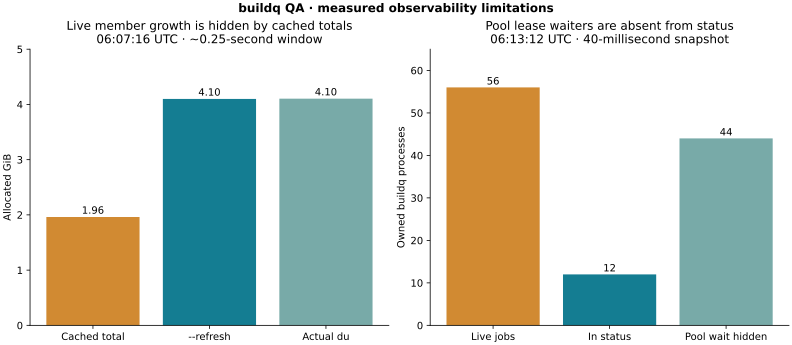
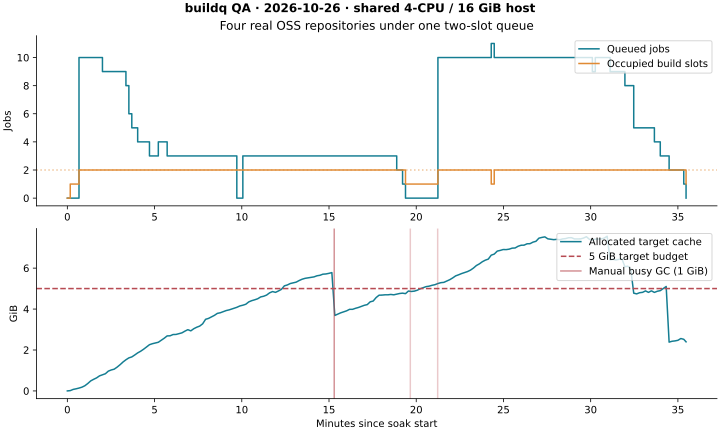

# Real OSS and queue QA (2026-10-26)

The experiment uses buildq at `1391d00`, Rust 1.89.0, Linux overlayfs, a
4-CPU quota, and a 16 GiB cgroup memory limit. Other QA agents run independent
experiments on the same host. Timings measure this contended environment;
they do not establish a standalone Cargo-versus-buildq speedup.

Four pinned repositories are exercised: Bevy v0.16.1 (`bevy_ecs`), Tokio
1.45.1, ripgrep 14.1.1 (the complete application), and rust-analyzer
2025-06-02 (`syntax`, plus a separately measured complete rust-analyzer binary).
See `environment.json` for exact revisions. Bevy and rust-analyzer selected-crate
soak results must not be read as builds of their entire repositories.

The existing seeded soak runner rotates three detached worktrees per repository
through debug/release builds, feature switches, tests, comment edits/reverts,
parallel bursts, cancellation, and periodic normal/1 MiB pressure GC. It uses
`slots=2`, one Cargo job per admitted build, a 5 GiB target budget, and a 6 GiB
free-space reserve. Its own queue, targets, temporary directories, logs, and
Cargo home are under `/workspace/qa-oss`; registry source/download caches are
shared with the other experiments. All target caches start empty. Clone/source
and Cargo registry bytes are outside buildq's target budget.

`burst.py` adds twelve simultaneous real builds (four repositories × three
worktrees) to that same queue. The report retains every stdout/stderr and a
2-second queue/RSS time series. `real-edit.py` develops two extra detached Tokio
worktrees: each exports a different constant and adds a test asserting its value.
Their source mtimes are identical and backdated to 2023. Eight alternating test
runs switch default/full features, so a stale artifact produces a failing
assertion. These code changes remain entirely in the scratch worktrees.

Use `reproduce.sh` from the buildq checkout with `QA_ROOT` and `QA_BUILDQ` set.
The primary soak runner is resumable using the same seed. The supplemental
scripts are bounded one-shot scenarios. No branch, issue, or pull request is
created in any upstream OSS repository.

## Measurement caveats

- Aggregate RSS sums each process's RSS, including shared pages more than once.
- The custom burst samples only its own child process trees. The existing soak
  runner's `max_tree_rss_kb` samples named cargo/buildq/rustc processes globally,
  so other experiments on this host can contribute; this metric is not isolated.
- Queue samples apply to this experiment's own `BUILDQ_DIR`. Cancellation and
  process-group cleanup checks are scoped to jobs that the runner starts.
- This is a bounded short soak, not evidence that 24–48 hours of use passes.
- Overlayfs results do not validate reflink savings on APFS, XFS, or Btrfs.

## Supplemental observations

A full rust-analyzer binary build succeeded with 186 compiler messages in
762.866 seconds including FIFO queue wait. Cargo's own elapsed build time was
9m53s under the shared host's contention. Its scoped process-tree peak RSS was
1,823,993,856 bytes (1.70 GiB). Three subsequent builds compiled zero crates;
Cargo reported about 0.3 seconds, while end-to-end times were 17.64, 37.37, and
18.42 seconds because they waited in the same loaded queue. The staged
`--version` command also succeeded. The upstream build script warns that it
cannot find `.git/HEAD` inside a detached Git worktree; this warning does not
prevent the build or staged application from running.

All eight divergent Tokio marker tests passed, including feature switches and
identical backdated source mtimes. All three real ripgrep staged runs found
exactly 10,000 anchored matches in a 100,000-line input file.

The initial 12-job burst completed all 12 builds successfully in 442.368 seconds,
with at most two observed build holders, ten visible waiters, and a scoped
1,435,492,352-byte (1.34 GiB) peak RSS for its own child process trees. Its
per-job finish timestamps use two-second polling and include that measurement
resolution; full application measurements use the existing process sampler.

At 06:05:49 UTC, a manual foreground GC with a temporary 1 GiB budget freed
2,361,716,736 bytes from eight idle items without failed deletions. Busy
artifacts remained protected and the JSON explicitly reported the remaining
soft-limit excess. `manual-busy-gc.json` records the complete result.

The initial soak was intentionally terminated and resumed with the same seed
and original deadline. Before resuming, the host's non-reaping PID 1 retained a
terminated rustc process as a zombie (state `Z`, zero RSS), which the runner
reported as an orphan/cancellation failure. The original summary and process
state are retained. The resumed run uses the Linux child-subreaper helper from
the storage QA harness; the full raw summary must not be described as entirely
green by silently excluding the original environment-related failure.

Two observability enhancements have concrete evidence:

- In an 81-millisecond parallel snapshot, normal `cache ls --json` reported
  2,106,675,200 bytes, while `du` reported 4,406,718,464 bytes. An immediate
  `--refresh` reported 4,401,590,272 bytes. The busy rust-analyzer member's
  estimate was about 732 seconds old. Per-member timestamps already exist,
  but the headline total does not explicitly mark that it contains stale
  estimates. See `freshness-snapshot.json`.
- During the 64-job burst, a 40-millisecond snapshot found 56 live child buildq
  processes, of which only 12 appeared in queue status. The other 44 were
  waiting for pool members before queue admission. See
  `burst64-visibility-snapshot.json`. A separate five-second sample of 33
  hidden waiters used only 0.07 CPU seconds (about 1.3% of one CPU), so this
  observation establishes a visibility gap rather than high polling CPU.

## Final result

The seeded soak completed 2,128.3 seconds (35m28s): 19 actions, including three
bursts and two GC passes. The recorded peak allocated target footprint was
8,112,721,920 bytes (7.56 GiB), and the host retained at least 11,545,702,400
bytes (10.75 GiB) free. No slot-limit, stranded-ticket, GC-error, accounting,
or storage-policy invariant failed. The final refreshed, idle cache measured
2,715,021,312 bytes (2.53 GiB), below its 5 GiB budget, with zero holders and
zero waiters.

The later 64-job burst completed **63 builds successfully**. The harness
terminated the remaining Bevy build with SIGTERM at its 900-second bound; its
exit code was 143. The burst's scoped peak RSS was 1,981,906,944 bytes (1.85 GiB).
It used the same queue while the soak switched repositories and forced GC,
so this is a mixed warm/cold pressure experiment, not an all-warm throughput
measurement.

The terminated job (`qa-burst64-bevy-2-08`) entered the visible queue about
793.006 seconds after its stderr log was created immediately before process
spawn. That interval includes process startup, Cargo/Git preflight, and pool
admission; the logs cannot isolate pure pool wait. It then waited 56.8 seconds
in the visible queue and ran for 50.428 seconds before the harness deadline.
Four later submissions to the same worktree completed at burst offsets
376.755, 473.866, 747.654, and 851.758 seconds. Member admission has a long tail
that the queue's history timestamps do not expose. Exact history timestamps,
labels, log-file birthtimes, and timing definitions are retained in
`burst64-admission-latency.json`.

The raw soak summary is **failed** and is retained without edits. Its three
failed action outcomes come from five failing test jobs: three repetitions of
ripgrep's ancestor-`.git` environmental test and two Tokio tests missing the
required `full` feature. Plain Cargo independently reproduced Tokio's exact
`_require_full` compile error in a separate target (`logs/controls/`). The
initial non-reaping-host cancellation also produced the documented zombie
failure. These results must not be summarized as a completely passing soak or
as demonstrated artifact corruption. The Tokio preset needs fixing before a
clean full-OSS soak can be claimed.

`raw-logs.tar.gz` contains the complete raw experiment log directory, including
stdout/stderr, queue samples, original summaries, history, controls, and final
cache/status snapshots. `observations.json` contains a compact derived result.
The supplemental scripts passed Ruff formatting and lint checks.

## Raw log archive layout

`raw-logs.tar.gz` preserves the log tree. Extract it into `logs/` to restore individually named stdout/stderr referenced in this report. JSON summaries and time series remain loose.
