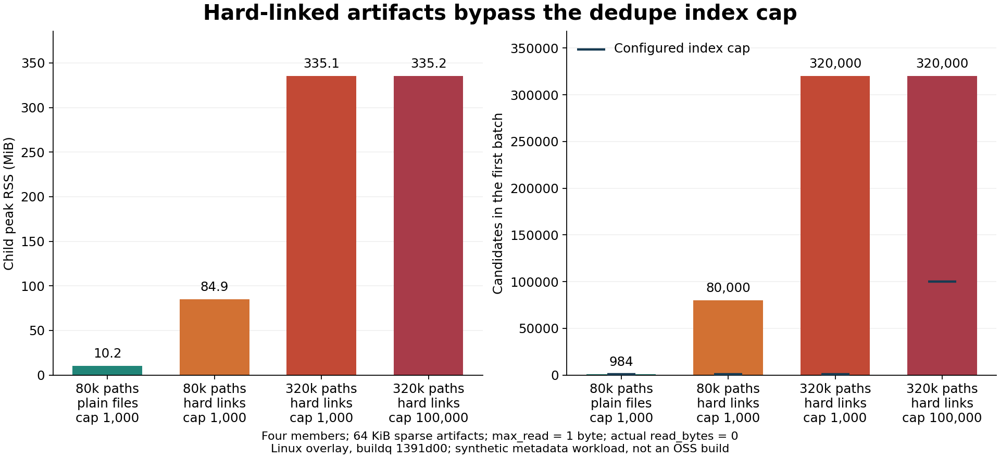
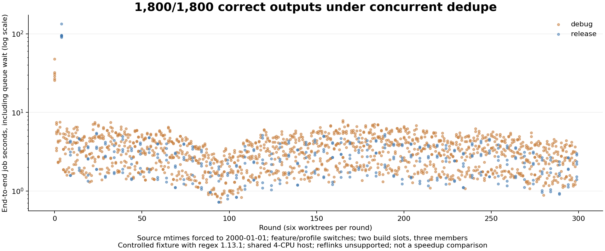

# Cross-member sharing QA

Tested buildq `1391d00` on 2026-10-26, Linux x86_64, Rust 1.89.0,
4-CPU cgroup quota, 16 GiB memory limit. Other QA workloads were running on
the same machine: wall times below are observations under shared load,
not isolated performance comparisons.

## Confirmed finding: hard links bypass index batching (#140)

Cargo commonly creates hard links between an output in `debug/deps` and its
uplifted path. `index()` keeps every file with `nlink > 1`, including files
outside the current hash batch (`src/dedupe.rs:1193`). Thus a low
`dedupe_max_index` does not bound candidate metadata for these artifacts.

This condition also covers mbx artifacts hard-linked to a store outside the
member, even when no uplifted alias exists inside that member. The real mbx
native test independently found 66 hard-linked dependency groups across
members (`native-mbx-same-inode-scan.json`), establishing that the relevant
link-count shape occurs in the new integration.

All metadata-scale measurements use four members, 64 KiB sparse artifact
files, logical accounting and `dedupe_max_read = '1'`. `read_bytes` is zero
in every row: the growth happens before content comparison. Peak RSS is
`resource.getrusage(RUSAGE_CHILDREN).ru_maxrss`, in Linux KiB; each script
invocation starts exactly one child process. The child is the release buildq.

| Paths | Same-member hard-link aliases | max_index | First-batch candidates | Peak RSS (KiB) | Wall seconds |
| ---: | :--- | ---: | ---: | ---: | ---: |
| 40,000 | No | 1,000 | 988 | 10,496 | 0.506 |
| 80,000 | No | 1,000 | 984 | 10,496 | 1.083 |
| 80,000 | Yes | 1,000 | 80,000 | 86,928 | 2.177 |
| 320,000 | Yes | 1,000 | 320,000 | 343,164 | 7.417 |
| 320,000 | Yes | 100,000 (default) | 320,000 | 343,296 | 8.829 |

The equal-path-count 80,000-path comparison isolates the alias effect.
The 320,000-path default-cap case confirms that it also occurs with the
default setting. These are synthetic metadata cases, not an assertion that
one tested OSS repository has this artifact count. No OOM was induced.



Reproduce with a fresh root:

```sh
python3 metadata_scale.py --root /workspace/qa-sharing/repro-plain \
  --buildq /workspace/qa-bin/buildq --files-per-member 20000
python3 metadata_scale.py --root /workspace/qa-sharing/repro-links \
  --buildq /workspace/qa-bin/buildq --files-per-member 10000 --hardlinks
python3 metadata_scale.py --root /workspace/qa-sharing/repro-large \
  --buildq /workspace/qa-bin/buildq --files-per-member 40000 --hardlinks \
  --max-index 100000
```

Raw evidence: `metadata-normal.json`, `metadata-normal80k.json`,
`metadata-hardlink.json`, `metadata-hardlink320k.json`,
`metadata-hardlink320k-default.json`. Plot reproduction: `plot_metadata.py`.

### Dry-run estimates and work are multiplied across batches

With two members containing 100 unique 1 KiB artifacts each, plus one
same-member alias per artifact, the content-based duplicate potential is
100 KiB, counting each inode once. `max_index = 10` produces 40 batches.
The dry run reports 4,000 identical copies and 4,096,000 identical bytes,
40 times the real potential, and performs 40 copies of the comparison work
(`alias-repeat.json`).

Changing only the cap back to 100,000 on those same files produces one batch,
100 identical copies and exactly 102,400 identical bytes
(`alias-repeat-default.json`), confirming that the estimate depends on the
batch count rather than the underlying data.

Each batch includes all hard-linked candidates. `share_scope()` also creates
a fresh `Planned` set for each batch (`src/dedupe.rs:859`), so it does not
remember that a previous batch compared the same pair of inodes. On this
unsupported volume dry-run projection cannot record them as shared, exposing
the repeated work and inflated estimate. No files were modified by the dry run.

```sh
python3 metadata_scale.py --root /workspace/qa-sharing/repro-repeat \
  --buildq /workspace/qa-bin/buildq --files-per-member 100 --members 2 \
  --artifact-bytes 1024 --max-index 10 --max-read 1G --hardlinks
```

A correction should retain aliases only for selected candidate inodes, keep
per-pass inode-pair accounting across batches, and preserve complete alias
tracking when replacing paths on macOS. Validate both bounded memory and
invariance of duplicate estimates as the batch cap changes.

## Runtime correctness and filesystem fallback

`worktree_churn.py` creates six real Git worktrees of a local Rust application
using cached regex 1.13.1. Two build slots and three pool members force member
reuse and queueing. Every source write has its mtime restored to
2000-01-01. The executable checks regex behavior and prints a source marker,
the selected feature state and `env!("CARGO_MANIFEST_DIR")`; the harness
requires all three to match the invoking worktree. It alternates feature
flags and switches to release mode every fifth round.

The completed initial run passed **180/180 real builds and executions** in
287.69 seconds with seeding enabled. Median end-to-end job time was 2.797 s;
the largest was 120.373 s, including cold release compilation and queueing.
The evidence is `churn-seed-results.jsonl` and `churn-seed-summary.json`.
This is a correctness stress test; it is not a seed-on/off speed comparison.

The identical-source variant also passed **180/180** jobs in 309.12 seconds
with seeding disabled. It writes the same source bytes in every worktree and
still requires the embedded manifest directory to identify the invoking
worktree. This specifically exercises cross-root invalidation when Git blob
content alone cannot distinguish worktrees. Raw evidence:
`churn-identical-results.jsonl`, `churn-identical-summary.json`.

The workload uses the real Cargo registry artifacts, but the application is
a controlled fixture, not a huge OSS checkout. Other QA tracks cover OSS.

The filesystem is overlay. A direct `FICLONE` probe returned
`EOPNOTSUPP (95)`; real `cache dedupe` reported
`FIDEDUPERANGE: Invalid argument (os error 22)`, persisted
`sharing.state = unsupported`, and reported zero shared bytes. Subsequent
dry runs preserved that capability state while measuring content duplication.
Seeding fell back to ordinary member reuse. These runs validate the fallback,
not successful copy-on-write seeding or physical storage savings on APFS,
Btrfs or reflink-enabled XFS.

The longer concurrent run passed **1,800/1,800** real builds and executions
over **1,639.78 seconds (27.33 minutes)**. Together the three completed
workload variants passed **2,160/2,160** output checks. The concurrent test
alternates real and dry-run dedupe every 0.5 seconds while compilation and
staged runs contend for members.

| Concurrent-run measurement | Result |
| --- | ---: |
| Median end-to-end job | 2.949 s |
| Maximum end-to-end job, including cold builds and queueing | 133.289 s |
| Build queue median / p95 / maximum | 0.088 / 1.559 / 89.858 s |
| Run queue p95 / maximum | 0.002 / 0.019 s |
| Concurrent dedupe command samples | 3,157 |
| Aggregate busy-member/pair skip events | 7,408 |
| Collector-lock contention skips | 75 |
| Collector errors / unexpected exit outcomes | 0 |
| Maximum observed dedupe command duration | 0.572 s |

These skip events can revisit the same busy member on several passes; they
are not counts of distinct builds. A collector skipped because another
collector holds its lock is an expected CLI outcome. Final `status --json`
had no waiters and every holder idle (`churn-contention-final-status.json`).
The run validates output correctness and safe fallback/locking on this
unsupported volume; it does not exercise successful physical deduplication.



Evidence: `churn-contention-summary.json`, `churn-contention-results.jsonl`,
`churn-contention-history.jsonl`, representative stderr/cache reports, and
`churn-contention-dedupe-examples.json`. The full background collector log is
gzip-compressed in `churn-contention-dedupe.jsonl.gz` (standard `gzip -dc`
prints JSONL). Reproduce the longer run with:

```sh
python3 worktree_churn.py --root /workspace/qa-sharing/repro-contention \
  --buildq /workspace/qa-bin/buildq --rounds 300 --seed-members true \
  --concurrent-dedupe
```

`collect_churn.py` archives a completed workload; `plot_churn.py` reproduces
the latency figure from the archived results.

## Additional findings

- `cross-member-hardlink-finding.md` documents same-inode files across
  members being counted as new sharing opportunities, with a minimal runtime
  reproduction and independently observed real mbx shim hard links.
- `interrupted-seed-finding.md` documents a deliberately injected abandoned
  `.seed-mN` directory omitted from both accounting and GC. The recovery-state
  behavior is reproduced; a natural kill during a supported reflink clone was
  not reproduced on this volume.

## Measurement caveat

`unsupported_volume.py` repeats dedupe over two identical allocated 256 MiB
artifacts. Each unsupported ioctl returns in a few milliseconds, while the
report's `read_bytes` charges the full 512 MiB comparison budget. Thus this
field is charged comparison work, not observed bytes read from storage;
do not infer I/O throughput from it. Eight passes are preserved in
`unsupported-volume-results.json`. No repeated 512 MiB physical I/O was
observed or claimed.
