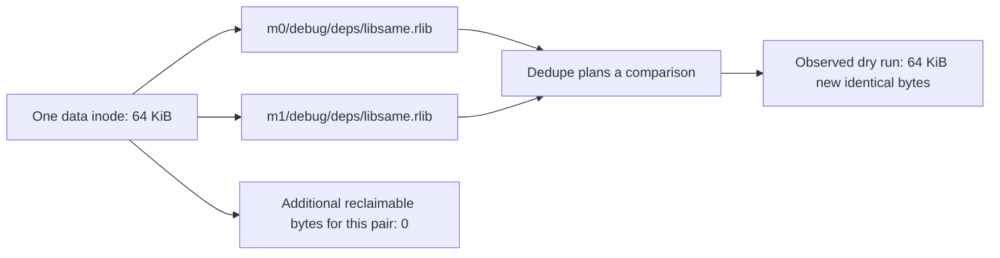

# Cross-member hard links are treated as newly shareable copies

Observed with buildq `1391d00`, Linux overlay, Rust 1.89.0. This is distinct
from the dedupe batching issue tracked in #140.

## Reproduction

```sh
python3 cross_member_hardlink.py \
  --root /workspace/qa-sharing/repro-cross-member \
  --buildq /workspace/qa-bin/buildq
```

The script creates one 64 KiB file in `m0` and a hard link to it at the same
relative path in `m1`. Both files have the same device and inode, and their
link count is two. They already share their data completely; there are no
additional blocks to reclaim by sharing this pair.

`cache dedupe --dry-run --json` nevertheless reports:

```json
{"compared":1,"identical":1,"identical_bytes":65536,
 "already_shared":0,"already_shared_bytes":0,"read_bytes":131072}
```

The corresponding text explicitly says `would share 64.0 KiB` and
`already shared: 0 files, 0 B` (`cross-member-hardlink-dry.txt`).

The actual pass attempts `FIDEDUPERANGE` and records `sharing.state =
unsupported`, with `Invalid argument (os error 22)`, rather than recognizing
the same inode. Full raw reports and file identities are preserved in
`cross-member-hardlink.json`.

The dry-run accounting error is reproduced. This volume genuinely cannot
reflink, so this run **does not establish** that a supported filesystem would
be marked unsupported. Trying a dedupe operation on the same inode/range is
unnecessary, and its behavior should also be covered on a supported volume.

## Real mbx relevance

The mbx QA track observed the same real 15,759,656-byte mbx build-script-shim
executable hard-linked across Tokio and ripgrep pool members, including
debug/release paths. See the actual-path/device/inode evidence in
`../mbx/cross-member-hardlinks.json`; the identical device/inode matches are
real mbx outputs, not the synthetic reproduction above. Dedupe indexes these
`.mbx-build-script-shims` paths; its only excluded private directories are
`incremental`, `.fingerprint` and its own temporary files.

An idle real-mbx cache dry run was also captured in
`../mbx/real-mbx-dedupe-dry-run.stdout`: 250 indexed paths,
58 identical copies / 147,664,896 identical bytes, but zero already-shared
copies and zero skipped hard links. Its cache contains the independently
verified same-inode shims. The total identical bytes also includes other
artifacts, so it must not all be attributed to the same-inode case.

The native mbx scenario gives stronger dependency-artifact evidence:
`native-mbx-same-inode-scan.json` independently records **66** same-inode
groups across members, including `libserde` and `libregex_syntax`, with
154,066,944 bytes of already-shared allocated footprint beyond the first
member. A dry run of that idle real cache reports zero already-shared copies,
79 identical copies / 234,098,688 identical bytes, and 468,706,260 comparison
budget bytes (`native-mbx-dedupe-dry.json`, capped at 512 MiB). That estimate
also contains other copies and stops at the read limit; only the independently
scanned 66 groups are proven hard-linked, and the whole estimate is not
attributed to those groups.

## Cause and desired behavior

`src/dedupe.rs`'s `plan()` treats identical `(dev, ino)` as settled only when
the two candidates also have the same `member_key()`. Already hard-linked
files in different members therefore become comparison work. Recognize the
same inode across member boundaries, report it as already shared or skipped,
charge no new savings/comparison work, and avoid issuing a dedupe ioctl for
the same inode. Continue taking the required member locks and preserving
correct per-pool accounting. Add both a synthetic regression and a real mbx
shim scenario; test capability reporting on a supported filesystem separately.


