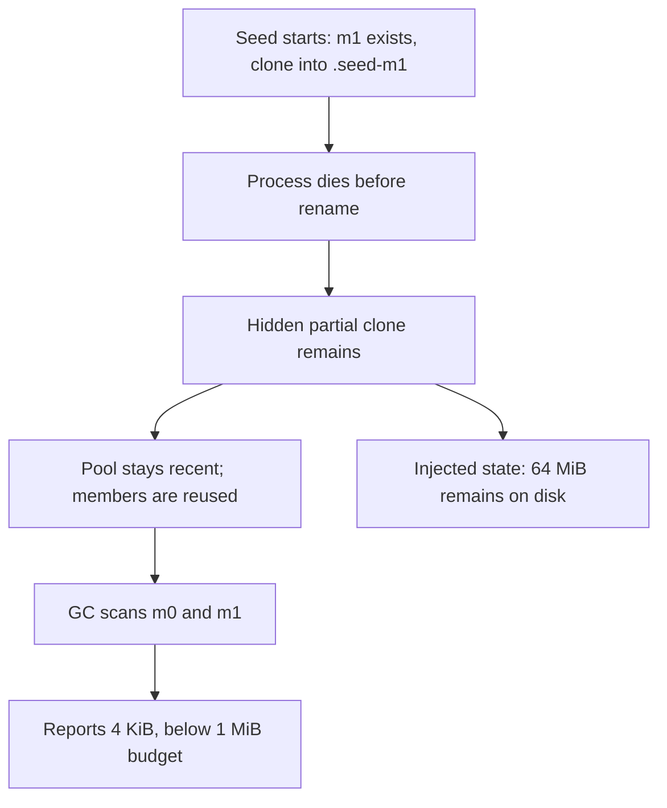

# GC omits abandoned partial seed directories

**Fault-injection test, not a natural kill-during-reflink reproduction.**
This machine's overlay filesystem cannot reflink. The test constructs the
on-disk recovery state that `seed_member()` can leave if its process is
killed while it clones a member.

## Reproduction and observation

```sh
python3 interrupted_seed.py \
  --root /workspace/qa-sharing/repro-interrupted-seed \
  --buildq /workspace/qa-bin/buildq
```

The fixture creates a recent pool with a tiny completed `m0`, the empty `m1`
and member metadata/locks written before cloning starts, and a hidden
`.seed-m1/partial-artifact` containing 64 MiB of allocated data. The temporary
data models an abandoned clone whose original source has since been rebuilt
or evicted. A fresh reflink would initially share its source's blocks; this
test does not claim that cloning itself always allocates another 64 MiB.

With a 1 MiB cache budget:

- `cache ls --refresh --json` reports 4,096 bytes and `over_budget = false`.
- Foreground `gc --json` reports 4,096 bytes before and after, zero freed,
  no actions and `over_budget = false`.
- The 64 MiB partial artifact remains. `du -sk` reports approximately 64 MiB
  under the cache.

Raw results: `interrupted-seed.json`.

## Source path and recovery gap

`seed_member()` in `src/pool.rs:709` clones into `.seed-mN`, then removes
the empty `mN` and renames the temporary directory into place. Its normal
error paths remove the temporary directory; abrupt process death does not
run those paths. A subsequent seed for the **same destination ID** cleans
the old temporary directory, but ordinary reuse of the existing empty
member does not call `seed_member()` again.

`gc::scan_with()` counts `mN` member directories, runs and trash, and omits
this temporary directory. Collection therefore cannot recognize the budget
overflow or reclaim the stale temporary data while the pool stays recent.
Repeated abandoned destinations could accumulate invisible storage.

Recover orphan `.seed-mN` directories while holding that destination's
member lock and the required pool coordination; skip in-progress clones.
Account for any protected temporary storage until it can be safely removed.
Add a process-kill recovery test on a supported reflink filesystem as a
separate validation step. This local test validates the cleanup/accounting
behavior of the injected recovery state only.


