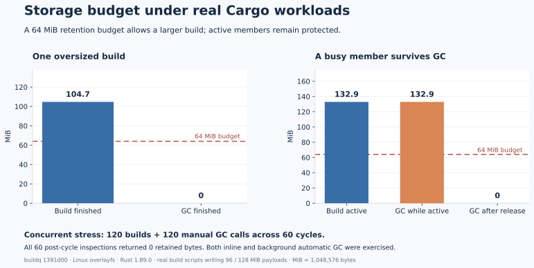
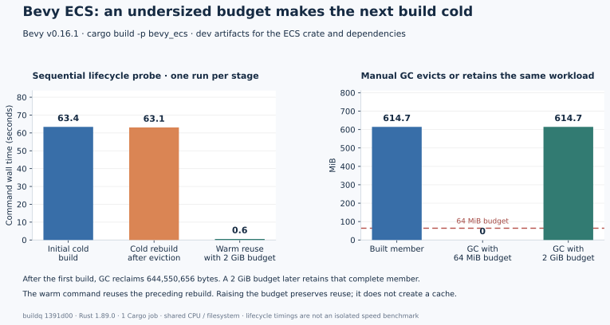
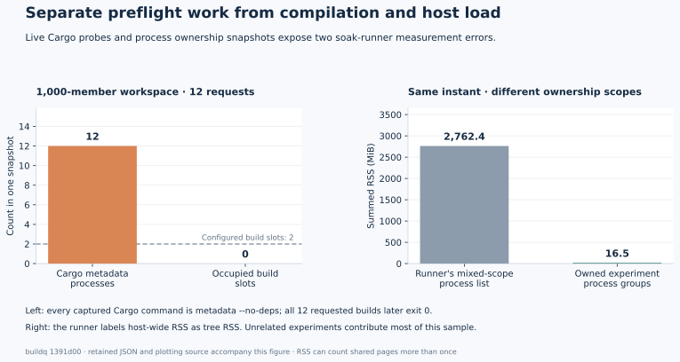

# Storage / GC runtime QA

Baseline: buildq `1391d00`; Linux overlayfs; Rust 1.89.0; all experiment state isolated under `/workspace/qa-storage`. These are real Cargo jobs with build scripts, generated source fixtures, and independent Git worktrees. No product code or third-party repository was changed.

## 45-minute resumed soak

Four fixture repositories with six worktrees each rotate builds, tests, release profiles, feature flags, source edits/reverts, bursts, cancellations, and ordinary/forced-budget GC through two slots. The cache budget is 60 MiB, samples run every five seconds, and every fourth scheduled action runs GC. One planned stop at 18.35 minutes resumes the same seed and original start time; the final run reaches its 45-minute deadline and finishes its last action normally.

| Measurement | Result |
| --- | ---: |
| Total observed elapsed time | 2,706.0 s |
| Scheduled actions | 2,954 |
| Cargo invocations, including burst children and cancellations | 2,607 |
| Intentional cancellation actions | 179 |
| Correctness-marker checks | 1,719 / 1,719 correct |
| Manual/forced GC invocations | 738 |
| Cumulative bytes reclaimed by these GC actions | 16,016,752,640 bytes (14.92 GiB) |
| Samples | 537 |
| Unexpected exits, leftovers, GC errors, stranded tickets | 0 |
| Samples with occupied slot holders above the configured class limit | 0 |
| History wait p95 / max | 0.589 / 2.018 s |
| Final retained cache / pending trash | 21,217,280 / 0 bytes |

The unmodified runner summary deliberately remains **passed=false**: eight of nine invariant categories pass, while its Cargo-process-count heuristic emits two `slot_limit` alarms. It counts metadata/version probes as builds, as the independent live-argv reproduction demonstrates. Those alarms are retained rather than rewriting the raw result. No sample shows an excess of actual occupied slot holders. See [findings.md](findings.md), issue #143, and `soak-summary.json`.

`soak-derived-summary.json` derives explicit job/output/GC counts from the unchanged `soak.jsonl.gz`. `soak-jobs.tar.gz` contains all 6,690 job stdout/stderr files. Both archives were byte-verified; `soak-manifest.json` records hashes. `supervisor-console.txt` records the planned restart and supervisor reaping; no live experimental jobs remain. Raw runner `max_tree_rss_kb` is kept for transparency but is contaminated by unrelated host compilers (#145); the derived owned-group RSS is labelled separately and is not a complete descendant-tree estimate.

This validates a 45-minute mixed workload with restart recovery. It does not establish 24–48-hour or multi-day behavior.

```sh
python3 summarize.py --log soak.jsonl.gz --output /tmp/storage-derived-summary.json
```

## Focused probes

| Scenario | Observed result | Evidence |
| --- | --- | --- |
| One job exceeds the entire 64 MiB budget | Build succeeds, emits the oversize warning; measured cache is 109,756,416 bytes | `probe-logs/oversize-build.stderr`, `probe-logs/oversize-cache.stdout` |
| Manual GC after oversize build | Dry run and actual GC both reclaim 109,756,416 bytes; cache reaches zero | `probe-logs/oversize-gc-dry.stdout`, `probe-logs/oversize-gc.stdout` |
| Rebuild after that eviction | Recompiles successfully, as expected for an evicted target | `probe-logs/oversize-cold-rebuild.stderr` |
| GC during a held 128 MiB build-script payload | Busy payload survives; after job exit GC reclaims the member | `probe-logs/busy-gc.stdout`, `probe-logs/busy-after-gc.stdout` |
| SIGKILL while a build-script payload is held | Buildq exits -9; watchdog releases the lease after stopping descendants; foreground GC and a correctness-marker cargo run succeed | `probe-logs/kill-*.stdout`, `probe-logs/kill-recovery-run.stdout` |
| Five consecutive oversized builds with inline automatic GC | All succeed; every post-build cache inspection reports zero bytes | `probe-logs/inline-*-after.stdout` |
| Two simultaneous oversized jobs plus two foreground GCs, repeated 30 times in each automatic-GC mode | 120 real Cargo builds and 120 manual-GC invocations complete; all 60 post-cycle cache inspections report zero; competing collectors report a skipped pass | `parallel-gc-logs/results.json` |
| min_free admission failure | Deliberately impossible 64 GiB reserve refuses the build with exit 125 and leaves no held slots | `parallel-gc-logs/minfree-admission.stderr`, `parallel-gc-logs/minfree-status.stdout` |
| Running-build min_free failure | Set reserve to initial free minus 256 MiB. Build starts; payload reaches 160 MiB; guard exits 125 after 3.180 s. Subsequent status has no held slots | `minfree-runtime-logs-2/result.json`, `minfree-runtime-logs-2/build.stderr` |

The running free-space test raises the reserve; it does **not** fill the physical disk. Other experiments share the volume, so concurrent writes can contribute to crossing that reserve. Its result proves guard activation during an actual running job, not sole attribution of the disk delta to that job. The initial, narrower 16 MiB-margin attempt was refused during admission; retained under `minfree-runtime-logs` for transparency.

The cache budget is a soft retention policy. A job larger than that budget can run, but retaining its next warm build requires raising the budget or reducing artifacts. The free-space reserve supplies the separate hard running-build guard.

`parallel-gc-logs/raw.tar.gz` contains all 600 per-cycle stdout/stderr files; they were byte-verified against the original files before archiving. `results.json` keeps every parsed GC result, build exit status, and duration directly inspectable. The final min_free admission evidence remains unpacked next to it.



## Actual Bevy artifacts larger than the budget

A separate local clone of the pinned Bevy v0.16.1 repository builds `bevy_ecs` and its dependencies offline, with one Cargo job. This scopes the experiment to the ECS crate rather than the complete renderer. Every command succeeds and final queue status has no occupied slots.

| Step | Wall time | Retained cache |
| --- | ---: | ---: |
| Initial build with 64 MiB budget, automatic GC disabled | 63.396 s | 644,550,656 bytes (614.7 MiB) |
| Manual GC with 64 MiB budget | 0.119 s | 0 |
| Cold rebuild after eviction | 63.066 s | 644,550,656 bytes |
| Raise budget to 2 GiB and reuse that target | 0.573 s | 644,550,656 bytes |
| Manual GC with 2 GiB budget | 0.023 s | 644,550,656 bytes |

These are one-run lifecycle observations on shared CPU and storage, not a controlled general speed benchmark. Completion is waited separately from the disk safety monitor; Python's timeout wait loop can still add up to approximately 50 ms. The warm invocation directly reuses the preceding rebuild; changing the budget alone does not create or prepopulate artifacts. Both oversized builds emit the documented warning. A 64 MiB retention limit cannot retain this workload, while 2 GiB can.

`bevy-budget-exact-logs` retains the table's raw build/GC output, command timings, source revision, and gzipped Cargo.lock with its SHA256 in `methodology.json`. To reproduce the exact dependency resolution, pass `--lock bevy-budget-exact-logs/Cargo.lock.gz` to `bevy-budget.py`; it copies the lock only into the experiment's own clone. Original third-party sources remain untouched.

The earlier exploratory pass remains under `bevy-budget-logs`: its cold builds took 162.557 and 159.629 seconds and it exhibited the same retention behavior. That pass polled a safety monitor every 0.2 seconds; short-command timings can include one polling interval. The second pass runs later on the same shared host with substantially different contention. Neither pass isolates host-load effects, so the difference is not presented as a product performance change.



## Metadata / measurement accuracy probes

`metadata-burst.py` creates 1,000 tiny workspace members and starts twelve buildq builds of one selected member. All twelve complete successfully. Captured snapshots contain twelve real `cargo metadata` processes while build slots are entirely idle. This provides a concrete reproduction for the soak runner's Cargo-process-count false alarm; details and three QA confidence findings are in [findings.md](findings.md).



Ten alternating warm builds of that workspace produced these end-to-end medians under the shared 4-CPU quota:

| Command | Median |
| --- | ---: |
| Plain Cargo, private warmed target | 0.557 s |
| buildq, warmed pool, automatic GC disabled | 1.197 s |

These measure tiny warm work in an unusually wide synthetic workspace. They expose preflight/manifest overhead; they do not estimate a full Bevy or rust-analyzer build's slowdown. There is no CPU isolation from other QA agents. Raw commands/phase traces are in `metadata-warm-logs`, and the exact baseline/queue/cache choices are in that directory's `methodology.json`.

## Reproduction

Activate the Rust toolchain and install Python 3.12 plus psutil first. Use a fresh writable root and the same immutable buildq binary. These tests never use normal user caches.

```sh
python3 probe.py --root /tmp/buildq-storage-probe \
  --buildq /path/to/buildq --output /tmp/buildq-storage-logs
python3 subreaper.py python3 parallel-gc.py \
  --root /tmp/buildq-storage-probe --buildq /path/to/buildq \
  --output /tmp/buildq-parallel-logs --cycles 30
python3 subreaper.py python3 minfree-runtime.py \
  --root /tmp/buildq-minfree --buildq /path/to/buildq \
  --output /tmp/buildq-minfree-logs
python3 subreaper.py python3 metadata-burst.py \
  --root /tmp/buildq-metadata --buildq /path/to/buildq \
  --output /tmp/buildq-metadata-logs --members 1000 --jobs 12
```

The scripts pin the real Cargo path used in this environment (`/workspace/.buildq-env/cargo/bin/cargo`); adjust it when reproducing elsewhere. `parallel-gc.py` intentionally reuses the fixture created by `probe.py`. It stops if available disk falls below 6 GiB. `subreaper.py` requires Linux and supplies a reaping init for the experiment's descendants.
