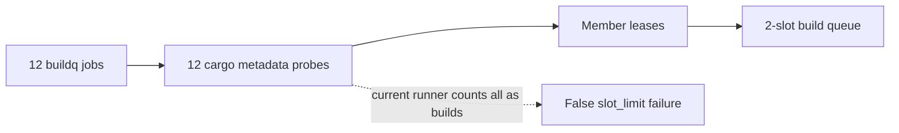
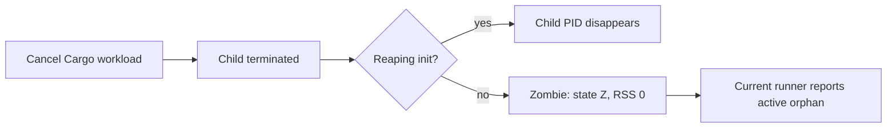

# QA confidence findings

Measured on buildq `1391d00`, Linux overlay filesystem, Rust 1.89.0. Product source was not modified. Every queue/cache/config/worktree is isolated under `/workspace/qa-storage`.

## Soak runner counts probe Cargo processes as slot oversubscription

Suggested labels: `bug`, `testing`, `observability`; priority medium (false alarm in the endurance gate).

`evaluate_sample` in `scripts/buildq_bench/soak.py` counts every process whose `comm == "cargo"` inside an owned live job group, then reports `slot_limit` when this exceeds `2 * slots`. This includes `cargo -V` and `cargo metadata --no-deps --format-version 1 --offline`, which run before slot acquisition. It does not establish simultaneous compilation above the limit.

Natural reproduction: the supervised six-worktree burst reported five Cargo processes with two configured slots, while slot status had exactly two holders. An independent owned-descendant sampler captured fifteen occasions with more than four Cargo processes; the first has seven and every command is metadata or `-V`. See `cargo-process-probes.json`.

Independent reproduction using real Cargo without wrappers: `metadata-burst.py` generates a 1,000-member workspace and launches twelve builds of one tiny member. `metadata-burst-logs/result.json` captures twelve simultaneous Cargo processes, all running metadata, with no occupied build slots in that snapshot; all twelve jobs exit zero. No Rust compiler was observed in those metadata snapshots. This is a harness false positive, not evidence of a queue violation.

Expected: distinguish queued heavy executions from preflight probes, retain argv/role in evidence, and assert actual slot holders or compiled workload concurrency. Preserve metadata CPU/RSS separately because it can still be a performance concern in very large workspaces.

## Soak runner cannot distinguish unreaped zombies from running descendants

Suggested labels: `bug`, `testing`, `observability`; priority low/medium (misleading failure classification).

An unsupervised baseline (`seed=26026`, 4 fixture repositories × 6 worktrees, 2 slots, 60 MiB budget, samples every 5 seconds) ran 102 actions in 167.1 seconds. It reports 27 `no_orphan_processes` samples and five cancellation-cleanup examples. `zombie-evidence.json` retains the failing actions and a contemporaneous `ps` read: all five leftover PIDs are `Z`, PPID 1, RSS 0. They are already terminated and cannot be killed again.

`process_rows()` only records PID/PPID/PGID/RSS/comm. Both `evaluate_sample()` and `reap_group()` include zombies without process state; `reap_group()` waits its full 15-second grace period and attempts SIGKILL on the group. Consequently a non-reaping container init can fail a run and add 15 seconds to cancellations even when the workload was terminated. The existing documentation correctly requires a reaping init for detached collection, but the runner does not retain enough evidence to diagnose this distinction.

Expected: capture process state, report zombies and live descendants separately, and explicitly identify missing reaping supervision. Keep the init prerequisite visible; do not silently declare a process-cleanliness pass when zombies accumulate. `subreaper.py` supplies a Linux-only test supervisor using PR_SET_CHILD_SUBREAPER and waitpid; it does not change buildq.

These findings concern the QA runner's classification. The recorded states do not demonstrate an active buildq compiler leak or a slot-cap breach.

## Soak summary labels host-wide compiler RSS as the workload process tree

Suggested labels: `bug`, `performance`, `testing`; priority medium (invalid workload resource attribution when other projects run concurrently).

`relevant_processes()` includes both owned process groups and every host process named buildq/cargo/rustc. `summarize()` then sums every returned RSS into `max_tree_rss_kb`. Therefore unrelated queues, compilers, or agents inflate the result even though all experiments use separate BUILDQ_DIR/cache locations.

`rss-scope-evidence.json` preserves an actual supervised soak sample: the reported host-wide RSS is **2,828,744 KiB**, but the runner's owned live/dead PGIDs total **16,860 KiB** at that instant. The largest owned sum across the sampled prefix is **290,820 KiB**. Several unrelated rustc processes contribute hundreds of MiB each; their PGIDs do not occur in the sample's owned live/dead sets.

Expected: retain two explicitly named metrics, host-wide compiler pressure and owned workload-tree RSS, and use the latter for workload benchmark comparisons. Counting shared pages more than once is a separate known RSS limitation; it does not explain inclusion of wholly unrelated process groups.
