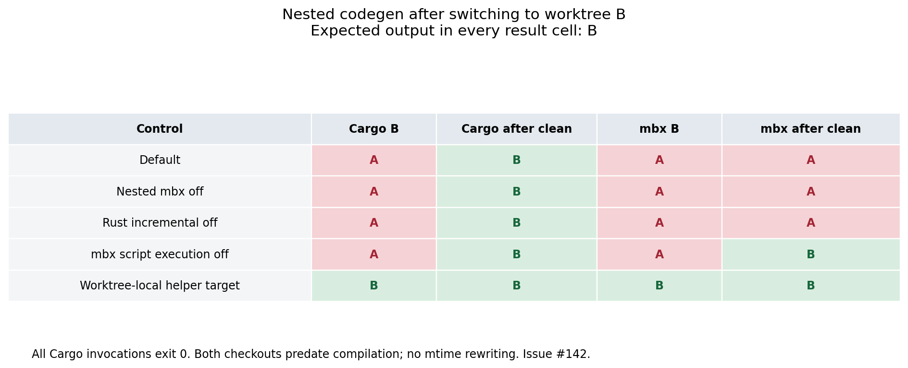
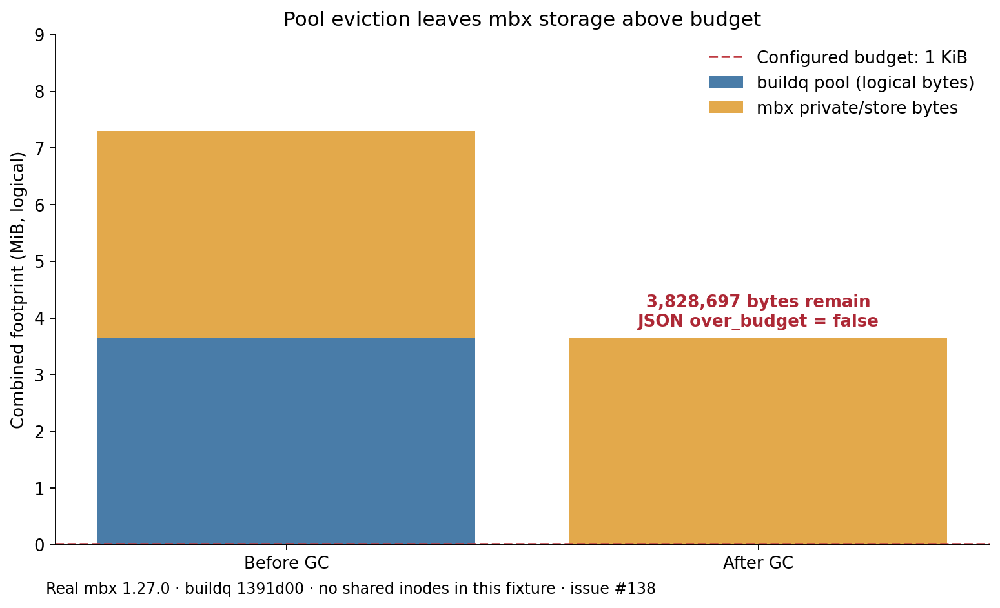
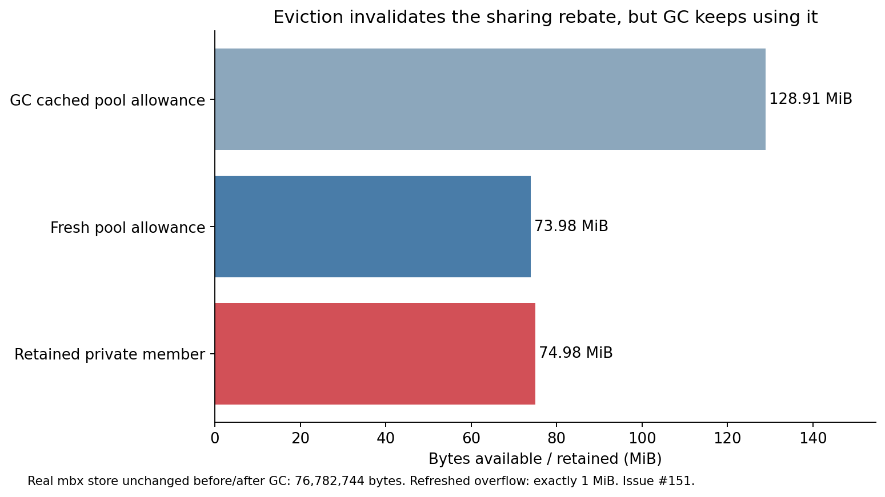
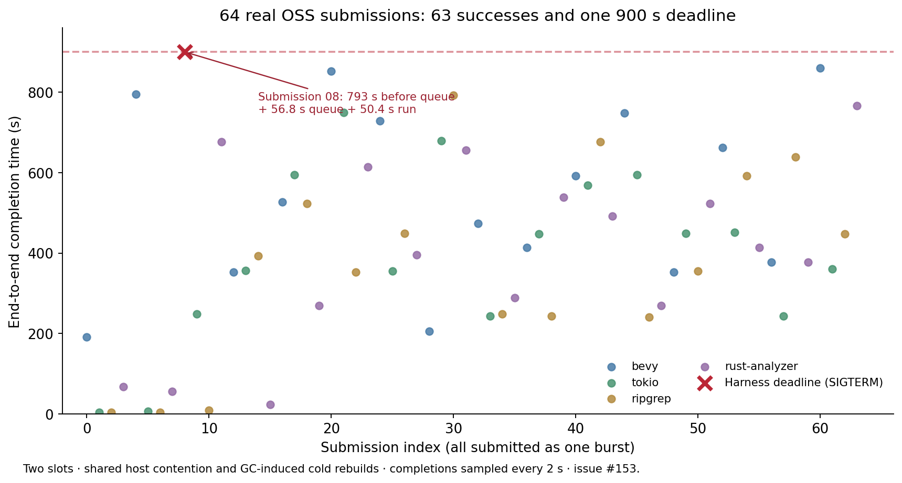
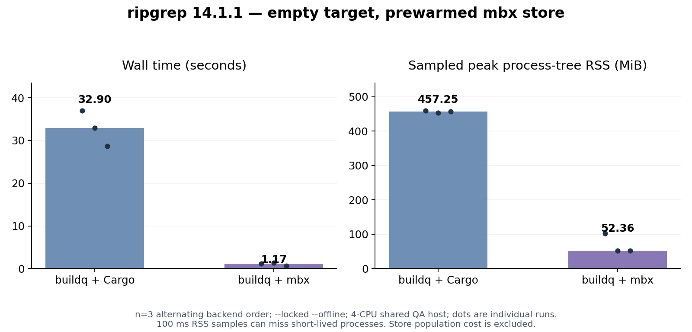
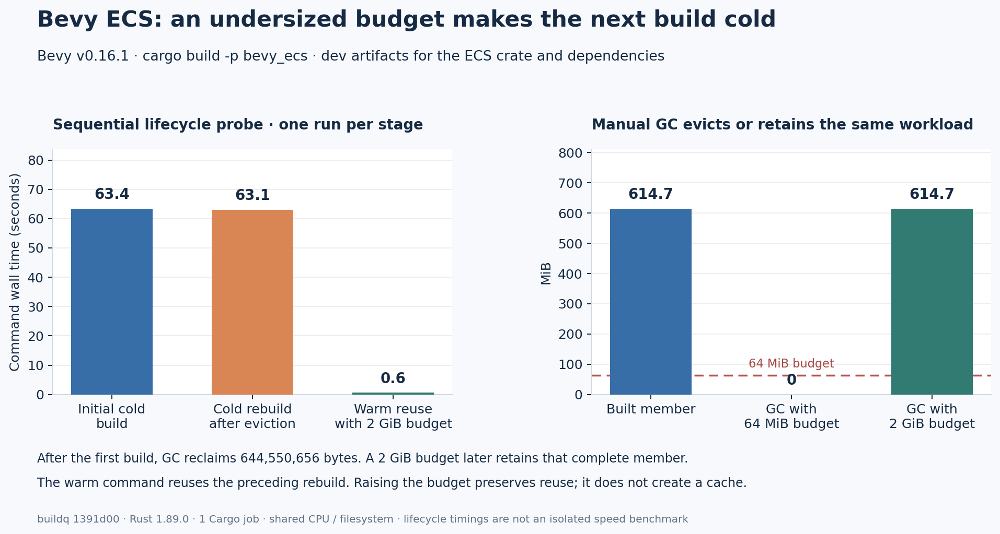
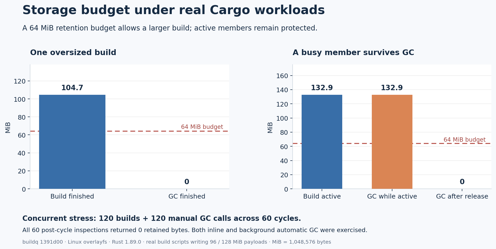
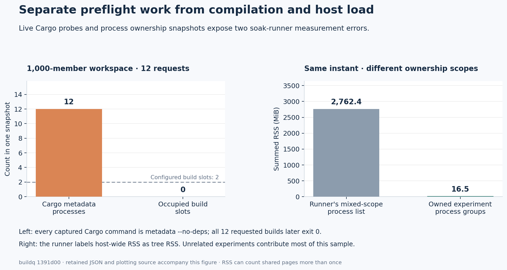

# Complex OSS, sharing and mbx QA — 2026-10-26

English | [日本語](qa-2026-10-26.ja.md)

Real builds, output assertions and sustained cache churn found a high-priority nested-codegen freshness defect, three mbx budget defects and two hardlink dedupe defects. The findings and measured improvement requests are registered in [issues #138–#153](https://github.com/r4ai/buildq/issues?q=is%3Aissue+is%3Aopen+created%3A2026-10-26).

This report evaluates buildq `1391d005b732a858140bbf7f8f76df9397b2a90b`. The PR preserves fixtures, raw evidence, measurements and figures. Runtime product source is unchanged.

## Environment and method

- Linux x86_64, 4-CPU cgroup quota, 16 GiB memory limit, 32 GiB overlay volume
- Rust/Cargo 1.89.0 and real mr-boxington/mbx 1.27.0
- Four QA agents plus the primary agent; separate queues, configurations, targets, stores and worktrees
- All agents share the host CPU quota: elapsed timings include contention and queueing
- No issue, PR or other remote mutation was made to any validation OSS repository

[Environment and binary hashes](data/qa-2026-10-26/environment.json) pin the executable versions. OSS revisions and commands are retained in each track's records. Source edits happened only in local QA checkouts.

| Track | Workload | Evidence |
| :--- | :--- | :--- |
| OSS | Bevy v0.16.1, Tokio tokio-1.45.1, ripgrep 14.1.1, rust-analyzer 2025-06-02; 12- and 64-submission bursts, source edits, staged runs, full application build | [OSS report](data/qa-2026-10-26/oss/README.md) |
| mbx | Three-pair ripgrep restore comparison, Bevy PBR/PNG dependency fixture, rust-analyzer checks, native PCRE2, feature/profile and project switches | [mbx report](data/qa-2026-10-26/mbx/README.md) |
| Storage | Oversized real Cargo jobs, busy/idle GC, SIGKILL recovery, runtime free-space guard, concurrent collectors, resumable fixture endurance | [Storage report](data/qa-2026-10-26/storage/README.md) |
| Sharing | Six worktrees, old source mtimes, embedded paths, feature/profile changes, concurrent dedupe, hardlink scaling and crash-state injection | [Sharing report](data/qa-2026-10-26/sharing/README.md) |
| Dual GC | Two edited worktrees, real mbx, both automatic collectors enabled, foreground pressure against both stores and executable-output assertions | [Dual-GC report](data/qa-2026-10-26/dual-gc/README.md) |

The normal Rust suite passed **159 tests**, and all **3 ignored real-Cargo tests in `tests/e2e.rs`** passed, including real mbx with two second-worktree cache hits. A paired check isolated the environment-sensitive test failure in #141; it is not a product target-selection failure. [Baseline logs](data/qa-2026-10-26/baseline/).

## Registered findings

| Issue | Classification / priority | Reproduced behavior |
| :--- | :--- | :--- |
| [#142](https://github.com/r4ai/buildq/issues/142) | Bug / high | A different worktree's nested codegen helper silently produces old output; mbx can retain it after pool cleanup |
| [#138](https://github.com/r4ai/buildq/issues/138) | Bug / medium | mbx alone exceeds the budget, but an empty buildq pool reports no overflow |
| [#139](https://github.com/r4ai/buildq/issues/139) | Bug / medium | Cached usage from another mbx store causes unnecessary eviction or missing reservation |
| [#140](https://github.com/r4ai/buildq/issues/140) | Bug / medium | Hardlinks bypass index batching; memory and repeated dry-run savings grow beyond the configured bound |
| [#147](https://github.com/r4ai/buildq/issues/147) | Bug / medium | Cross-member same-inode files are compared and classified as new sharing potential |
| [#141](https://github.com/r4ai/buildq/issues/141) | Test bug / low | A unit test fails whenever the caller sets `CARGO_TARGET_DIR` |
| [#143](https://github.com/r4ai/buildq/issues/143) | QA bug / medium | Cargo metadata/version probes produce false slot-limit failures |
| [#144](https://github.com/r4ai/buildq/issues/144) | QA bug / low | The runner labels unreaped zombies as live orphan workloads |
| [#145](https://github.com/r4ai/buildq/issues/145) | Measurement bug / medium | Runner tree-RSS summary includes other agents' unrelated builds |
| [#146](https://github.com/r4ai/buildq/issues/146) | Enhancement / low | Safe metadata reuse could reduce warm-build preflight cost in large workspaces |
| [#148](https://github.com/r4ai/buildq/issues/148) | Enhancement / medium | Headline cache totals should explicitly identify stale/busy size estimates |
| [#149](https://github.com/r4ai/buildq/issues/149) | Recovery enhancement / medium | An injected abandoned seed staging tree is neither counted nor reclaimed |
| [#150](https://github.com/r4ai/buildq/issues/150) | Enhancement / medium | Member-leasing waiters are invisible before ordinary queue admission |
| [#151](https://github.com/r4ai/buildq/issues/151) | Bug / medium | GC retains a hardlink-overlap rebate after evicting the last linked member |
| [#152](https://github.com/r4ai/buildq/issues/152) | QA bug / medium | The pinned Tokio test preset omits its required full feature |
| [#153](https://github.com/r4ai/buildq/issues/153) | Enhancement / medium | Member admission allows a large pre-queue tail and later-submission overtaking |

### Nested codegen correctness

The standalone fixture has an excluded helper Cargo workspace. Its parent `build.rs` runs that helper through the shim into `OUT_DIR/helper-target`, then embeds its output. Worktrees A and B, including B's changed helper source, exist before the first compilation. No backdated mtimes are needed.

Building A then B returns `generated=A` from B with exit code zero. Cleaning the pool corrects ordinary Cargo, but the mbx build-script execution cache can replay the bad result produced earlier under source B. Direct mbx builds with independent targets produced correct A/B; the evidence does not establish an independent upstream mbx freshness defect.

A worktree-local helper target passed the fixture. `CARGO_INCREMENTAL=0` and disabling nested mbx routing did not fix shared-target freshness. `MBX_BUILD_SCRIPT_EXECUTION=0` prevented persistence after pool cleanup, but did not fix initial member reuse. [Independent outputs and ablations](data/qa-2026-10-26/accounting/nested-controls/).

### mbx budget and identity

A tiny real mbx build left 3,828,697 logical bytes in mbx. With a 1 KiB budget, foreground GC emptied the buildq pool and then reported `over_budget=false`. The mbx bytes remained. A separate two-store experiment reused store A's reservation while the caller selected empty store B, evicting a 3,939,315-byte target that fit B's 6 MiB budget.

[Accounting probe and exact results](data/qa-2026-10-26/accounting/). These observations concern reporting/reservation. buildq should continue leaving mbx-owned entries to mbx's collector.

A controlled regex-dependency restore also kept a **57,597,010-byte sharing rebate** after GC removed its linked member. The mbx store stayed fixed at **76,782,744 bytes**. GC reported compliance with a retained private member, while refreshed inventory showed exactly **1 MiB** of combined overflow. Store-alone usage fit the budget, isolating this from #138. [Reproducer and cached bookends](data/qa-2026-10-26/accounting/eviction-rebate/).

### Hardlink sharing

At `dedupe_max_index=1000`, a 320,000-path hardlinked fixture retained 320,000 candidates and used 343,164 KiB peak RSS before reading any artifact bytes. The default 100,000 cap also retained all 320,000. An equal 80,000-path plain-file control used 10,496 KiB versus 86,928 KiB with aliases.

The small repeated-batch fixture also reported 40 times the unique duplicate potential. A separate cross-member same-inode fixture was unnecessarily compared and reported as new potential; actual mbx caches contain the same pattern in native dependencies and generated shims. These are incorrect estimates and unnecessary work, not measured reclaimed capacity.

## Runtime and benchmark results

### Real OSS and concurrency

The initial 12-job cross-OSS burst passed **12/12** in **442.368 s**, with at most two observed build holders and a scoped sampled process-tree RSS peak of **1.34 GiB**. Queue delay and concurrent QA load contribute to completion time.

A full pinned rust-analyzer application build passed with **186 compilation lines**, **762.866 s** including queueing, and **1.70 GiB** sampled process-tree RSS. Three subsequent warm builds compiled zero crates; their 17.64/37.37/18.42 s end-to-end durations included queue waits. In the first, slot acquisition took 17.013 s while Cargo reported only 0.34 s. This separates queue latency from compiler/cache time.

Eight alternating Tokio tests with different worktree markers and equal old source mtimes passed. Three staged ripgrep runs each returned the expected 10,000 matches. The rust-analyzer staged version check passed.

The larger **64-submission** burst completed **63 builds**; one early Bevy build reached the harness's **900-second deadline** and was deliberately terminated while compiling. It spent approximately 793 seconds before ordinary queue enqueue, then 56.8 seconds queued and 50.4 seconds running. Later jobs for the same worktree finished earlier. This is a measured admission-latency/fairness limitation (#153), not a spontaneous compiler failure or proof of deadlock.

The **35-minute OSS soak** is not an all-green result: two Tokio test actions omit required `full` features (#152), a ripgrep integration case sees synthetic ancestor `.git` markers in this sandbox (plain-rg control reproduces it), and the initial unsupervised segment retains a zombie. Slot, stranded-ticket, GC, accounting and storage invariants reported no violation in that run. The raw failures remain in the evidence.

### mbx restore performance

Three alternating-order, offline ripgrep pairs began with empty buildq targets. The mbx store was already populated; population cost is excluded from restore timing.

| Backend | Median wall time | Median sampled tree RSS |
| :--- | ---: | ---: |
| Ordinary Cargo through buildq | 32.900 s | 457.25 MiB |
| mbx through buildq, populated store | 1.168 s | 52.36 MiB |

mbx restored 44/45/45 cached actions. This is a hot-store/cold-target comparison, not an end-to-end cold-store speedup or a comparison against mbx alone.

The Bevy **0.16.1 PBR/PNG/multithread fixture** took **448.920 s** with an initially cold mbx store, including dependency compilation and shared-host contention. Three empty-target restores took **6.170/6.917/6.420 s**, each with **269 hits**. The median was **6.420 s**. A real source edit returned the new C marker; switching back returned A. Six concurrent mixed-worktree runs also returned correct markers. This fixture exercises Bevy dependencies; the OSS track separately builds Bevy's actual ECS package.

Real bundled PCRE2 C compilation and repeated feature/environment changes passed. [Exact commands, pinned fixtures, lockfiles and measurements](data/qa-2026-10-26/mbx/).

### Storage, GC and recovery

Focused real-Cargo probes confirmed:

- A 96 MiB build-script payload may exceed a 64 MiB soft budget, reports an oversize warning, and is reclaimed once idle
- A busy 128 MiB payload is preserved; idle GC then reclaims it
- SIGKILL recovery releases the old workload and a subsequent marker build succeeds
- Sixty two-build/two-collector races pass, across inline/background collection modes; contended collectors report a skip
- Raising the reserve during a running build triggers exit 125 after approximately 3.18 s and leaves no occupied slot

A repeated real Bevy ECS budget lifecycle measured **63.4 s cold**, **63.1 s after budget eviction**, and **0.6 s warm** when the 614.7 MiB target was retained under a 2 GiB budget. These are one lifecycle under shared load, not a universal speedup estimate. The original higher-contention run is also retained.

The sharing track completed **2,160/2,160 output assertions**, including **1,800 jobs over 27.33 minutes** with **3,157 concurrent dedupe samples** and zero unexpected collector errors.

The resumed storage soak ran **2,706.0 s (45 minutes)**: **2,954 actions**, **2,607 Cargo invocations** including **179 intentional cancellations**, **1,719/1,719 checked outputs**, and **738 GC calls** reporting **14.92 GiB** reclaimed cumulatively. Raw `passed=false` is retained: its only two alarms are the known Cargo-probe slot-count heuristic (#143); no holder-limit, unexpected-exit, orphan, cleanup, GC, storage or accounting violation was observed. This is a bounded result, not multi-day validation.

The independent dual-GC fixture ran **1,800.228 s**, with **8,235/8,235 checked outputs** and zero nonzero command exits. It included **30 extra pressure cycles against both collectors**. This controlled fixture validates repeated edits and collector interference; it does not substitute for large-OSS or arbitrary nested-build correctness.

### Monitoring accuracy

Twelve real metadata probes can exist while zero build slots are held. A snapshot's raw tree-RSS total included 2,828,744 KiB of named processes while the experiment's own process groups accounted for 16,860 KiB. Process-group totals are not guaranteed complete descendant-tree totals; the report retains that scope distinction.

A simultaneous cached inventory/status/du sample reported 2,106,675,200 bytes while the actual cache used 4,406,718,464; immediate refreshed inventory measured 4,401,590,272. A busy rust-analyzer member's estimate was approximately 732 seconds old. During the 64-job burst, 44 of 56 live submitted jobs were absent from the normal queue display because they were waiting for pool members.

These monitoring observations do not demonstrate a hard-quota breach, compiler leak or global slot-cap violation. The corresponding Issues request explicit freshness, ownership and waiting-phase information.

## Limits and reproduction

This is session-bounded QA. It does not establish 24–48 hours of continuous correctness; [#38](https://github.com/r4ai/buildq/issues/38) remains the endurance tracker. Interrupted/resumed time, configured duration and actual jobs are recorded separately in raw logs.

The overlay volume returned `EOPNOTSUPP` for `FICLONE` and `EINVAL` for real dedupe. Safe fallback was exercised. Physical reflink savings, supported-filesystem seeding performance and actual kill-during-clone recovery were not measured. [#77](https://github.com/r4ai/buildq/issues/77) still tracks the supported-filesystem Bevy dedupe comparison. The `.seed-mN` recovery issue uses explicit fault injection.

The host init does not reap orphaned children. Supervised runs use the retained Linux subreaper; unsupervised zombie-only results are preserved and classified separately. No active compiler leak is inferred from a zero-RSS zombie.

Rust 1.89 produces mbx build-script declaration warnings in some scenarios. Results are pinned to that toolchain, not evidence for the repository's newer pinned toolchain, macOS, Windows or real SSH transport.

For reruns, build the tested revision with the tested Rust toolchain and use a new writable root. Each track includes exact argv/configuration and standalone reproducers. The data index lists archives and their contents; do not reuse a root unless the specific runner documents resume support.
